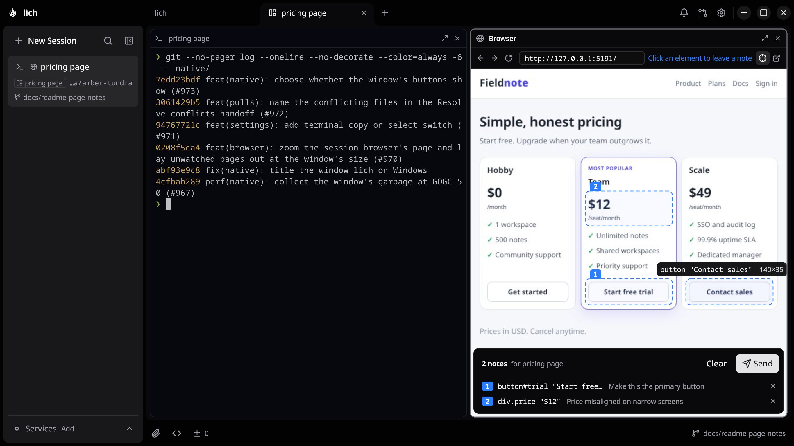

<div align="center">
  
  <h1>lich</h1>
  <p><a href="README.md">English</a> · <a href="README.pt-BR.md">Português (Brasil)</a> · <a href="README.es.md">Español</a> · <a href="README.zh-CN.md">简体中文</a> · <a href="README.ja.md">日本語</a> · <strong>한국어</strong> · <a href="README.ru.md">Русский</a></p>
  <p>
    <a href="https://github.com/lichdotdev/lich/releases"></a>
    
    <a href="LICENSE"></a>
    <a href="https://github.com/sponsors/omartelo"></a>
  </p>
  <p>
    <strong>코딩 에이전트를 나란히, 각자 자기 브랜치에서.</strong><br/>
    Claude Code, Codex, opencode 등 이미 쓰고 있는 에이전트를 각자 자기 worktree에서, 모두 한 창에서 실행하세요.
  </p>
  <h3><a href="#설치">lich 다운로드</a> · <a href="https://lichdotdev.github.io/lich/index.ko.html">lichdotdev.github.io/lich</a></h3>
  
  <!-- sponsor-logos: company logos go here, between the screenshot and Features -->
</div>

## 주요 기능

<table>
<tr>
<td width="50%" valign="middle">

### 에이전트를 나란히

세션을 분할 화면에 올려 두면 lich가 패널을 알아서 배치합니다. 어느 세션이 작업 중인지, 어느 세션이 내 응답을 기다리는지, 컨텍스트가 얼마나 남았는지 한눈에 보입니다.

</td>
<td width="50%"></td>
</tr>
<tr>
<td width="50%" valign="middle">

### 설정 없이 작업마다 worktree

원하는 베이스에서 세션을 분기하면 lich가 `.env` 파일을 복사하고 비어 있는 개발 서버 포트를 배정합니다. 커밋하지 않은 작업도 함께 가져갈 수 있습니다.

</td>
<td width="50%"></td>
</tr>
<tr>
<td width="50%" valign="middle">

### diff를 읽고, 줄마다 코멘트

에이전트가 바꾼 내용을 세션 옆에서 읽고, 손볼 줄에 코멘트를 달고, 모아 둔 코멘트를 프롬프트 하나로 세션에 돌려보냅니다.

</td>
<td width="50%"></td>
</tr>
<tr>
<td width="50%" valign="middle">

### 페이지를 가리키고, 에이전트에게 말하기

에이전트는 세션 옆 탭에서 브라우저를 조작하고, 당신도 같은 페이지를 씁니다. 잘못된 곳을 가리켜 메모를 남기고, 모든 메모를 하나의 프롬프트로 돌려보내세요.

</td>
<td width="50%"></td>
</tr>
<tr>
<td width="50%" valign="middle">

### 브라우저 없이 풀 리퀘스트

풀 리퀘스트를 열고, 그 브랜치의 에이전트에게 작성을 맡기고, 인라인으로 리뷰하고, 병합까지 한 창에서 끝냅니다.

</td>
<td width="50%"></td>
</tr>
<tr>
<td width="50%" valign="middle">

### 내 취향대로

JSON으로 테마를 가져오거나 git 저장소에서 설치합니다.

[문서 →](docs/themes.md)

</td>
<td width="50%"></td>
</tr>
</table>

그 밖에도:

- **일을 넘기는 세션.** 한 에이전트가 다른 세션에 작업을 넘기고 답을 돌려받습니다. 셸에서도 `lich` 명령으로 똑같이 쓸 수 있습니다([문서](docs/cli.md)).
- **샌드박스 에이전트.** 키, 자격 증명, 다른 저장소가 보이지 않는 샌드박스 안에서 에이전트가 권한 확인을 건너뛰도록 허용할 수 있습니다([한계](docs/ceilings.md)).
- **개발 서버를 사이드바에.** 프로젝트에서 계속 띄워 두는 것을 저장해 두면 클릭 한 번으로 시작하고 멈출 수 있습니다.
- **뭐든 바로 찾기.** `Ctrl`/`Cmd`+`K`로 세션 이름이나 세션에서 오간 내용으로 바로 이동합니다.
- **내가 필요할 때 알림.** 세션이 내 응답을 기다리면 데스크톱 알림이 뜹니다.

## 설치

```bash
curl -fsSL https://raw.githubusercontent.com/lichdotdev/lich/main/install.sh | sh
```

한 줄이면 됩니다. 배포판을 감지하고 다운로드를 검증한 다음, 패키지 매니저로 lich를 설치합니다.

| 플랫폼 | 설치 방법 |
| --- | --- |
| **Linux** | 위의 `install.sh` 또는 AUR [`lich-bin`](https://aur.archlinux.org/packages/lich-bin) (`yay -S lich-bin`). `zenity`와 glibc 2.34 이상(Debian 12, Ubuntu 22.04, RHEL 9 이상)이 필요합니다. |
| **macOS** | `brew install --cask lichdotdev/tap/lich` |
| **Windows** | [Releases](https://github.com/lichdotdev/lich/releases)의 설치 프로그램이나 포터블 zip, 또는 `scoop install https://github.com/lichdotdev/lich/releases/latest/download/lich.json` |

macOS와 Windows 빌드는 아직 서명되지 않아, Releases에서 받은 파일에는 Gatekeeper와
SmartScreen이 경고를 띄웁니다. Homebrew로 설치하면 Gatekeeper 경고는 뜨지 않습니다.
배포판별 패키지, Linux tarball, quarantine 플래그 지우기, 예전 Homebrew formula에서
업그레이드하는 방법은 [INSTALL.md](INSTALL.md)에 있습니다.

## 시작하기

1. **프로젝트를 엽니다.** 탭 줄의 `+`를 누르면 최근에 닫은 항목이 나오고 폴더 선택기가
   열립니다. 여기서 git 저장소를 고르세요.
2. **에이전트를 고릅니다.** 처음 실행하면 머신에서 찾은 에이전트 목록이 나옵니다.
   설정 › 프로바이더에서 기본값과 바이너리 경로를 지정할 수 있습니다.
3. **세션을 시작합니다.** *새 세션*을 누르면 프로젝트에서 에이전트가 열립니다. 체크아웃
   헤더의 `+`로는 원하는 에이전트나 일반 터미널을 바로 그 체크아웃에서 열 수 있습니다.
4. **worktree를 만듭니다** *(선택)*. 원하는 베이스 브랜치에서 하나 만들면 lich가 그 안에
   새 세션을 열어 줍니다.

## 프로바이더 지원

모든 에이전트는 실제 터미널에서 실행되고, 대화를 재개할 수 있으며, 샌드박스 안에서 동작하고,
다른 세션에 접근할 수 있습니다. 에이전트마다 다른 것은 lich가 세션에서 *읽어 올* 수 있는
정보입니다. CLI마다 기록하는 내용이 다르기 때문입니다.

<details>
<summary>에이전트별 지원 기능 보기</summary>

| 기능 | Claude Code | Codex | Antigravity | opencode | oh-my-pi | Crush | Cursor CLI | Kiro CLI |
| --- | :-: | :-: | :-: | :-: | :-: | :-: | :-: | :-: |
| 하단 바에 컨텍스트 윈도우 표시 | 예 | 예 | 아니요 | 아니요 | 아니요 | 아니요 | 아니요 | 예 |
| 직전 턴 중 프롬프트 캐시에서 읽은 비율을 하단 바에 표시 | 예 | 예 | 아니요 | 비용 툴팁에 | 비용 툴팁에 | 아니요 | 아니요 | 아니요 |
| 카드 툴팁에 실행 중인 모델 표시 (시작할 때와 바뀌었으면 시작 모델도) | 예 | 예 | 아니요 | 아니요 | 아니요 | 아니요 | 아니요 | 예 |
| 하단 바에 비용 표시 | 예 | 예 | 아니요 | 예 | 예 | 예 | 아니요 | 크레딧 |
| 남은 플랜 사용량 | 예 | 예 | 예 | OpenCode Go만 | 아니요 | 아니요 | 예 | 아니요 |
| 플랜 사용 한도에 걸려 멈춘 턴이 한도가 초기화되면 다시 이어짐 | 예 | 예 | 아니요 | CLI가 직접 재시도 | CLI가 직접 재시도 | 아니요 | 아니요 | 아니요 |
| 턴이 실행되는 동안 스피너, 끝나면 벨 | 예 | 예 | 예 | 예 | 예 | 아니요 | 예 | 예 |
| 카드 이름이 대화에 맞춰 붙음 | 예 | 첫 프롬프트로 | 첫 프롬프트로 | 예 | 예, 두 번째 턴부터 | 아니요 | 예, 첫 턴이 끝날 때 | 첫 프롬프트로, 첫 턴이 끝날 때 |
| 에이전트가 연 풀 리퀘스트가 턴이 끝나면 카드에 표시됨 | 예 | 예 | 예 | 예 | 예 | 아니요, 창이 다시 포커스를 받을 때 표시됨 | 예 | 예 |
| lich를 라이트/다크 테마로 전환하면 바뀐 모양으로 다시 그려짐 | 예 | 아니요 | 아니요 | 예 | 예 | 아니요 | 예 | 아니요 |
| 에이전트가 내 응답을 기다리며 막혔을 때 벨 | 예 | 예 | 아니요 | 예 | 아니요 | 아니요 | 아니요 | 아니요 |
| Ctrl+Shift+Y로 내 응답을 기다리는 다음 세션으로 이동 | 예 | 예 | 아니요 | 예 | 아니요 | 아니요 | 아니요 | 아니요 |
| 대화가 압축(compact)되는 중이면 카드에 표시됨 | 예 | 아니요 | 아니요 | 아니요 | 아니요 | 아니요 | 아니요 | 아니요 |
| 사이드바 상태 필터: 대기 중, 실행 중, 읽지 않음 | 예 | 예 | 대기 중 없음 | 예 | 대기 중 없음 | 아니요, 항상 유휴 | 대기 중 없음 | 대기 중 없음 |
| 다른 세션 안에서 에이전트가 실행한 경우(`claude -p`, `cursor-agent -p`) 그 세션의 카드에 끼어들지 않음 | 예 | 예 | 예 | 예 | 예 | 예 | 예 | 아니요 |
| 턴이 실행되는 동안 머신이 유휴 절전에 들어가지 않음 | 예 | 예 | 예 | 예 | 예 | 아니요 | 예 | 예 |
| 리뷰 탭의 **마지막 턴**과 에이전트의 요약 | 예 | 예 | 예 | 예 | 예 | 아니요 | 예 | 예 |
| 팔레트에서 대화 내용 검색 | 예 | 예 | 예 | 예 | 예 | 예 | 아니요 | 예 |
| lich 밖에서 시작한 대화를 팔레트의 기록 탭에서 재개 | 예 | 예 | 예 | 예 | 예 | Linux 지원, macOS와 Windows는 미검증 | 예 | 예 |
| 긴 붙여넣기를 접힌 자리 표시자 대신 편집 가능한 텍스트로 넣기(설정 › 프로바이더, 기본값은 꺼짐) | 예 | 아니요 | 아니요 | 예 | 측정 안 됨 | 아니요, `paste_N.txt` 첨부 파일이 됨 | 아니요 | 예 |
| 대화를 새 worktree로 포크, 같은 체크아웃에서도 포크 | 예 | 예 | 아니요 | 예 | 아니요 | 아니요 | 아니요 | 아니요 |
| 다른 카드에 열려 있는 대화를 에이전트 앱에서 직접 재개하면 경고 | 예 | 다음 프롬프트에서 | 다음 프롬프트에서, 미검증 | 아니요 | 예 | 다음 도구 호출 때 | 아니요 | 예 |
| 원하는 reasoning effort로 세션 열기 | 예 | 예 | 예 | 아니요 | 예 | 아니요 | 모델 이름으로 지정 | 예 |
| ultracode를 켠 채로 세션 열기 | 예 | 아니요 | 아니요 | 아니요 | 아니요 | 아니요 | 아니요 | 아니요 |
| 여러 계정을 프로필로 나란히 두고 프로필마다 따로 로그인하며, 다른 계정으로 옮긴 세션이 같은 카드에서 이어짐(설정 › 프로바이더) | 예 | 예, 플러그인은 프로필마다 따로 두고 개인 프로필의 설정은 모든 프로필이 공유 | 아니요 | 예, 터미널 카드에서 로그인. 대화가 로그인 정보와 같은 데이터베이스에 있어서 세션을 다른 프로필로 옮길 수 없음 | 예, 터미널 카드에서 로그인하며 설정은 모든 프로필이 공유 | 측정 안 됨 | Linux와 Windows(macOS에서는 로그인 정보가 키체인에 있음), 터미널 카드에서 로그인하며 `mcp.json`, hooks, skills는 모든 프로필이 공유 | Linux만(macOS는 로그인 정보를 키체인에 두고, Windows에서는 그 위치를 옮길 방법이 없음), 터미널 카드에서 로그인하며 대화는 모든 프로필이 공유 |
| 기본 계정에서 신뢰한 폴더는 다른 모든 프로필에서도 "trust this folder?" 질문 없이 열림 | 예 | 예 | 프로필 없음 | 아무것도 묻지 않음 | 아무것도 묻지 않음 | 측정 안 됨 | 예 | 아무것도 묻지 않음 |
| 샌드박스 안의 세션은 "trust this folder?" 질문 없이 열림 | 예 | 예 | 예 | 아무것도 묻지 않음 | 아무것도 묻지 않음 | 예, 프로젝트 초기화 여부도 더는 묻지 않음 | 예 | 아무것도 묻지 않음 |
| 신뢰한 폴더의 worktree는 "trust this folder?" 질문 없이 열림 | 예 | 예 | 예 | 아무것도 묻지 않음 | 아무것도 묻지 않음 | 예, 프로젝트 초기화 여부도 더는 묻지 않음 | 예 | 아무것도 묻지 않음 |
| `lich control`이나 에이전트로 실행 중인 세션 조작: 프롬프트, 중지, 모델, effort, 슬래시 명령 | 예 | 아니요 | 아니요 | 아니요 | 아니요 | 아니요 | 아니요 | 아니요 |
| 다른 세션이 보낸 메시지가 터미널에 타이핑되지 않고 전달됨 | 예 | 아니요 | 아니요 | 아니요 | 아니요 | 아니요 | 아니요 | 아니요 |
| 에이전트가 시작한 서브에이전트가 전용 카드를 가진 lich 세션으로 요청한 세션의 체크아웃에서 실행되고, 전체 보고서를 돌려준 뒤 끝나면 닫힘. 그 서브에이전트가 시작한 서브에이전트도 한 단계 아래에 카드를 가짐 | 예 | 아니요 | 아니요 | 아니요 | 아니요 | 아니요 | 아니요 | 아니요 |
| 실행 중인 세션을 멈추지 않고 따로 질문하기(`lich ask`) | 예 | 아니요 | 아니요 | 아니요 | 아니요 | 아니요 | 아니요 | 아니요 |
| CLI가 직접 측정한 컨텍스트, 비용, 플랜 사용량 | 예 | 아니요 | 아니요 | 아니요 | 아니요 | 아니요 | 아니요 | 아니요 |
| 터미널 상태 줄에 세션이 답해야 할 상대, 기다리고 있는 상대, 받아 갈 수 있는 답이 표시됨 | 예 | 아니요 | 아니요 | 아니요 | 아니요 | 아니요 | 아니요 | 아니요 |
| 서브에이전트나 workflow 단계에서 비공개로 위임 | 예 | 예 | 예 | 예 | 예 | 예 | 예 | 예 |
| 재개한 세션이 쓰던 모델과 effort를 유지 | 모델만 | 예 | 아니요 | 모델 | 예 | 아니요 | 모델 | 모델, effort는 미검증 |
| 결과를 기다리다 중단해도 결과를 나중에 받을 수 있음 | 예 | 예 | 예 | 예 | 아니요 | 예 | 예 | 예 |
| 다른 세션에 넘긴 작업은 그 에이전트가 답하지 않고 턴을 끝내는 즉시 "unanswered"로 보고됨 | 예 | 예 | 예 | 예 | 예 | 아니요, 마감 시각까지 기다림 | 예 | 예 |
| lich가 에이전트에게 보내는 메시지(넘긴 작업, 준비된 결과, 알림)가 선택한 프롬프트 언어로 전달됨 | 예 | 예 | 예 | 예 | 예 | 예 | 예 | 예 |
| 세션을 시작할 때 숨은 서브에이전트 대신 lich 세션으로 작업을 나누라는 안내를 프롬프트 언어로 받음 | 예 | 아니요 | 아니요 | 아니요 | 예 | 아니요 | 아니요 | 아니요 |
| 세션 카드가 에이전트가 조작하는 브라우저를 세션 옆 탭에 연다 | 예 | 예 | 예 | 예 | 예 | 예 | 예 | 예 |

</details>

빈칸은 모두 의도된 것이며, 각각 무엇을 측정했는지는
[`docs/ceilings.md`](docs/ceilings.md)에 정리되어 있습니다.

## 설정

- **프로바이더.** 설정 › 프로바이더에서 에이전트별 바이너리 경로와 모든 프로젝트에 적용할
  기본값을 지정하며, 프로젝트마다 따로 고를 수도 있습니다. 경로를 지정하지 않으면 lich는
  로그인 셸의 `PATH`에서 가장 먼저 찾은 바이너리를 실행하고, 버전이 둘 이상이면
  `lich doctor`가 경고합니다.
- **하단 바.** 설정 › 모양에서 항목을 끌어다 놓아 무엇을 표시할지 정합니다. 비용은 토큰당
  과금될 때만 의미가 있으므로 처음에는 숨겨져 있습니다.
- **worktree.** 프로젝트의 `.worktreeinclude` 파일로 gitignore된 파일 중 어느 것을 새
  worktree에 복사할지 정합니다.
- **세션 훅.** 설정에서 [lich 플러그인](https://github.com/lichdotdev/lich-plugin)을
  설치하면 세션이 자기 카드의 제목을 직접 정하고, 파일을 쓰는 즉시 git 상태를 새로 고칩니다.
- **스크립팅.** lich에서 스크립트로 안심하고 다뤄도 되는 부분은
  [docs/stability.md](docs/stability.md)에 정리되어 있습니다.

## 개인 정보와 업데이트

모든 것이 내 머신에서 실행됩니다. 계정도, 로그인도, 텔레메트리도 없습니다. lich가 네트워크에
접속하는 경우는 아래가 전부입니다.

- **업데이트**: 시작할 때와 매시간 GitHub Releases에서 새 버전을 확인하고, 시작할 때 lich
  플러그인의 릴리스 목록을 확인합니다.
- **플랜 사용량**: 각 프로바이더의 사용량 엔드포인트(Anthropic, OpenAI, Cursor, OpenCode Go)에
  에이전트가 이미 쓰고 있는 로그인 정보로 접속하며, 최대 5분에 한 번입니다. Antigravity의
  플랜은 `agy`에서 직접 읽습니다.
- **가격**: 번들된 가격표에 없는 모델이 있을 때 한 번, GitHub에 공개된 LiteLLM 가격표를
  받아 옵니다.

Windows 설치 프로그램으로 설치한 빌드는 lich가 직접 업데이트합니다. Homebrew, Scoop, AUR,
Linux 패키지로 설치했다면 해당 패키지 매니저로 업데이트하며, 실행할 명령은 lich가 알려 줍니다.
문제가 생겼다면 `lich doctor`가 설정을 점검하고, `lich rage`는 아무것도 업로드하지 않고
버그 리포트를 아카이브 하나로 모아 줍니다. 로그 파일을 첨부하기 전에 설정 › 도움말에서 로그에
무엇이 담기는지(경로, 프로젝트와 브랜치 이름, gh 로그인 계정이며 세션 토큰은 절대 담기지 않음)
확인할 수 있습니다. 버그와 기능 요청은 [이슈](https://github.com/lichdotdev/lich/issues)에
남겨 주세요. 버전별 변경 사항은 [CHANGELOG.md](CHANGELOG.md)에서 볼 수 있습니다.

## 소스에서 빌드

lich는 바이너리 두 개로 이루어집니다. 백엔드 `lich`는 정적 순수 Go 바이너리이고, 창
`lich-native`는 `native/`에서 cgo로 빌드합니다. 필요한 것은 **Go 1.27.0+**와
**[Task](https://taskfile.dev)**이며, 창을 빌드하려면 C 툴체인과 Gio의 시스템 패키지, 그리고
`native/GHOSTTY_COMMIT`에 적힌 커밋에서 빌드한 `libghostty-vt`가 추가로 필요합니다.
빌드 방법은 [`native/slice.sh`](native/slice.sh)에, 창에 대한 설명은
[`docs/native-window.md`](docs/native-window.md)에 있습니다.

```bash
task build          # 백엔드 바이너리 -> bin/lich
task build:native   # 창 -> bin/lich-native
task run            # 빌드 + 실행
task test           # Go 테스트 스위트
task package        # bin/에 .deb + .rpm + Arch .pkg.tar.zst (nfpm 필요)
```

에이전트를 하나 더 추가하려면 두 저장소에 걸쳐 파일 십여 개를 고쳐야 합니다.
어디를 고쳐야 하는지는 [`docs/adding-a-provider.md`](docs/adding-a-provider.md)에 정리되어 있습니다.

## 후원

lich는 한 사람이 만들고 유지 관리합니다. 후원금은 프로젝트에 들이는 시간을 뒷받침하고
프로젝트가 독립성을 지키게 해 줍니다. 앱에 유료 요금제는 없으며 앞으로도 생기지 않습니다.

[**후원하기**](https://github.com/sponsors/omartelo)

<!-- sponsor-names: monthly sponsors go here -->

### 후원해 주신 분들

<!-- backers: one-time supporters go here -->

아직 없습니다.

## 라이선스

[AGPL-3.0-only](LICENSE) © 2026 omartelo

lich는 자유 소프트웨어입니다. GNU Affero General Public License v3 조건에 따라 사용, 연구,
수정, 재배포할 수 있습니다. 배포하거나 네트워크로 제공하는 파생 저작물은 같은 라이선스로
공개해야 합니다. v0.9.0 이하 릴리스는 계속 MIT 라이선스를 따릅니다.
