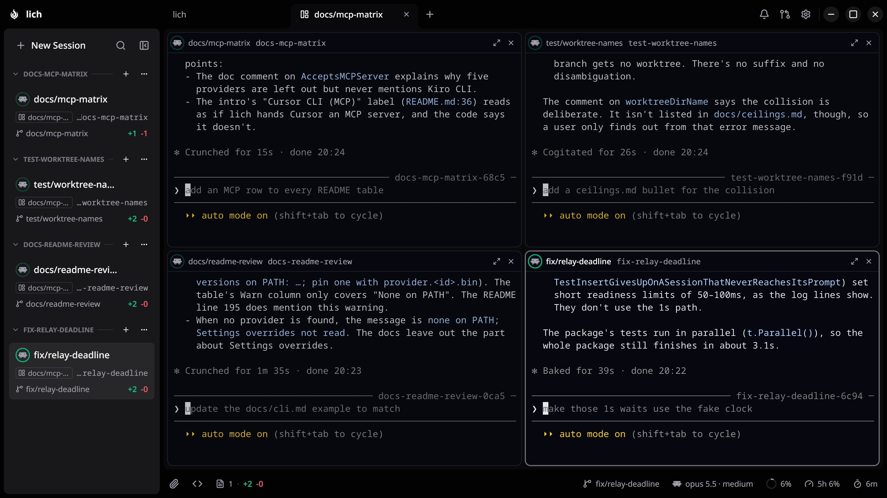

<div align="center">
  
  <h1>lich</h1>
  <p><a href="README.md">English</a> · <strong>Português (Brasil)</strong> · <a href="README.es.md">Español</a> · <a href="README.zh-CN.md">简体中文</a> · <a href="README.ja.md">日本語</a> · <a href="README.ko.md">한국어</a> · <a href="README.ru.md">Русский</a></p>
  <p><strong>Um ADE para quem trabalha no terminal, com os agentes de código que você já usa.</strong></p>
  <p>
    Abra seus projetos, rode agentes como Claude Code, Codex e opencode em
    terminais de verdade e acompanhe o git (worktrees, diffs e pull requests)
    sem sair da janela. Sem Electron e sem navegador: o lich desenha a própria
    janela nativa com Gio, no Linux, no Windows e no macOS.
  </p>
  <p><a href="https://lichdotdev.github.io/lich/"><strong>lichdotdev.github.io/lich</strong></a></p>
  <p>
    <a href="https://github.com/lichdotdev/lich/releases"></a>
    
    
    
    <a href="LICENSE"></a>
    <a href="https://github.com/sponsors/omartelo"></a>
  </p>
  
  <!-- sponsor-logos: company logos go here, between the screenshot and Why lich -->
</div>

## Por que o lich

O que dá para fazer com o lich:

- **Rodar o agente que você já tem.** [Claude Code](https://www.anthropic.com/claude-code),
  [Codex](https://github.com/openai/codex), Antigravity,
  [opencode](https://github.com/sst/opencode), oh-my-pi,
  [Crush](https://github.com/charmbracelet/crush),
  [Cursor CLI](https://cursor.com/docs/cli) e
  [Kiro CLI](https://kiro.dev/docs/cli/) rodam aqui do mesmo jeito. Aponte o
  lich para cada binário uma vez e escolha um padrão ou um agente por sessão.
  O que o lich consegue ler *de volta* de cada sessão muda de provedor para
  provedor, e está tudo na tabela de
  [Suporte por provedor](#suporte-por-provedor).
- **Usar um terminal de verdade.** Shells com PTY, vários por projeto,
  renderizados na GPU, com scrollback pesquisável que sobrevive a fechar e
  reabrir a janela. Defina um entrypoint (`lazygit`, `k9s`, `pnpm dev`) e o
  terminal abre direto nessa ferramenta, sempre, no Linux, no macOS e no
  Windows. Nenhum rc do shell nem perfil do PowerShell é carregado antes, então
  o entrypoint que funciona para você funciona para qualquer pessoa com quem
  você compartilhar. O rodapé acompanha o `cd` e mostra a branch. Numa sessão de Claude
  Code, Codex ou Kiro CLI, mostra também o modelo e a janela de contexto em
  uso; no Claude Code, Codex, Antigravity, Cursor CLI e numa assinatura do
  OpenCode Go, quanto ainda resta da janela móvel do seu plano; e, se você
  pedir, quanto a sessão já gastou, nos provedores que registram isso.
- **Pôr uma sessão para trabalhar para outra.** Passe uma tarefa para outro
  card e o agente de lá escreve a resposta de volta, seja qual for o agente em
  cada ponta. Ele chega às outras sessões por ferramentas entregues na criação
  da sessão (MCP no Claude Code e no Codex) ou trazidas pelo plugin. Tudo isso
  também existe como o comando `lich` em qualquer shell, com `--json`, então
  um script consegue conduzir uma sessão sem nenhum agente no meio
  ([`docs/cli.md`](docs/cli.md)).
- **Acompanhar várias ao mesmo tempo.** Coloque qualquer sessão num split ao
  lado da atual e o lich organiza os painéis sozinho, pela quantidade de
  sessões e pelo espaço da janela: oito ficam quatro por linha num monitor
  ultrawide e duas por linha num notebook. Uma sessão que delegou trabalho
  monta o split com as outras em volta dela num clique. Cada split tem nome,
  um projeto guarda quantos você quiser e cada um ganha um bloco na barra
  lateral, que dá para recolher, renomear ou desfazer.
- **Criar uma worktree sem fazer setup.** Crie uma a partir de qualquer branch
  base: o lich copia os seus `.env*` ignorados pelo git e reserva uma porta
  para o servidor de dev que nenhum outro checkout nem processo da máquina
  está usando.
  Tem mudança não commitada no checkout? Ela vai junto, inclusive os arquivos
  não rastreados.
- **Rodar uma sessão confinada.** O agente pode abrir dentro de uma sandbox
  do sistema operacional: um home novo e vazio, só com o estado do próprio
  provedor, o resto da máquina só para leitura e acesso de escrita ao checkout
  em que ele foi aberto. Suas chaves ssh, suas credenciais de nuvem e todos os
  outros repositórios do disco simplesmente não estão lá. É o contrapeso de
  deixar um agente pular os pedidos de permissão. No Linux roda com
  bubblewrap e no macOS com `sandbox-exec`. Não protege contra código
  malicioso, e o [`docs/ceilings.md`](docs/ceilings.md) diz o que ela não
  impede.
- **Revisar o diff no mesmo lugar em que você lê.** Um dock de diff
  mostra as mudanças em andamento ao lado de uma árvore de arquivos ao vivo,
  recolhe as que só mexeram em espaço em branco quando você pede e mostra o
  antes e depois de uma imagem ou PDF alterado. Clique com o botão direito
  numa seleção para comentar aquelas linhas; os comentários vão juntos para a
  sessão num prompt só, colado e não enviado. A aba Código navega pelo
  checkout e busca no texto dos arquivos.
- **Levar o pull request até o merge daqui.** Liste os pull requests abertos
  do repositório, faça checkout de um numa worktree própria, leia o diff,
  revise inline e faça o merge com os métodos que a branch base aceita de
  fato. Numa branch que ainda não tem pull request, **Criar com agente** pede
  para a sessão dessa branch abrir um, e nada é enviado até você apertar
  Enter.

Tem mais: [temas](docs/themes.md) que você importa como JSON ou instala de um
repositório git, uma paleta no `Ctrl`/`Cmd`+`K` que acha uma sessão pelo nome
ou pelo que foi dito na conversa, notificação no desktop quando uma sessão está
esperando por você e `lich rage` / `lich doctor` para quando ele nem abre.

O projeto está em desenvolvimento ativo: bugs e pedidos de funcionalidade vão
nas [Issues](https://github.com/lichdotdev/lich/issues), e o que mudou em cada
versão está no [CHANGELOG.md](CHANGELOG.md).

## Suporte por provedor

Todo provedor roda num terminal de verdade, é retomado pelo id da conversa,
fica confinado pela mesma sandbox e recebe o mesmo jeito de falar com as suas
outras sessões. O que muda é o que o lich consegue *ler* de cada sessão,
porque ele lê o que cada CLI registra, e não existem duas que registrem as
mesmas coisas.

| Recurso | Claude Code | Codex | Antigravity | opencode | oh-my-pi | Crush | Cursor CLI | Kiro CLI |
| --- | :-: | :-: | :-: | :-: | :-: | :-: | :-: | :-: |
| Janela de contexto no rodapé | sim | sim | não | não | não | não | não | sim |
| O tooltip do card mostra o modelo em uso, e com qual abriu se ele mudou | sim | sim | não | não | não | não | não | sim |
| Custo no rodapé | sim | sim | não | sim | sim | sim | não | créditos |
| Quanto ainda resta do seu plano | sim | sim | sim | só OpenCode Go | não | não | sim | não |
| Um turno interrompido pelo limite de uso do plano continua quando o limite renova | sim | sim | não | retenta sozinho | retenta sozinho | não | não | não |
| Spinner enquanto o turno roda, anel quando termina | sim | sim | sim | sim | sim | não | sim | sim |
| O card ganha o nome da conversa | sim | pelo seu primeiro prompt | pelo seu primeiro prompt | sim | sim, a partir do segundo turno | não | sim, quando o primeiro turno termina | pelo seu primeiro prompt, quando o primeiro turno termina |
| Um pull request aberto pelo agente aparece no card quando o turno termina | sim | sim | sim | sim | sim | não, só quando a janela volta ao foco | sim | sim |
| Se redesenha com o novo visual quando você troca o lich entre tema claro e escuro | sim | não | não | sim | sim | não | sim | não |
| Sino quando o agente depende de você para continuar | sim | sim | não | sim | não | não | não | não |
| Ctrl+Shift+Y pula para a próxima sessão esperando por você | sim | sim | não | sim | não | não | não | não |
| O card avisa quando a conversa está sendo compactada | sim | não | não | não | não | não | não | não |
| Filtro da barra lateral por estado: Aguardando, Rodando, Não lidas | sim | sim | sem Aguardando | sim | sem Aguardando | não, sempre Ociosas | sem Aguardando | sem Aguardando |
| Rodado pelo seu agente dentro de outra sessão (`claude -p`, `cursor-agent -p`), não aparece no card dessa sessão | sim | sim | sim | sim | sim | sim | sim | não |
| Impede a máquina de suspender por inatividade enquanto um turno roda | sim | sim | sim | sim | sim | não | sim | sim |
| **Último turno** na aba Revisão, com o resumo do agente | sim | sim | sim | sim | sim | não | sim | sim |
| Buscar na conversa pela paleta | sim | sim | sim | sim | sim | sim | não | sim |
| Retomar, pela aba Histórico da paleta, uma conversa iniciada fora do lich | sim | sim | sim | sim | sim | Linux; macOS e Windows sem teste | sim | sim |
| Um paste longo pode entrar como texto editável em vez de um placeholder recolhido (Configurações › Provedores, desligado por padrão) | sim | não | não | sim | não medido | não, vira o anexo `paste_N.txt` | não | sim |
| Fazer fork de uma conversa para uma nova worktree, ou no mesmo checkout | sim | sim | não | sim | não | não | não | não |
| Aviso quando você retoma, pelo app do próprio agente, uma conversa que já está aberta em outro card | sim | no seu próximo prompt | no seu próximo prompt, sem teste | não | sim | na próxima chamada de tool | não | sim |
| Abrir uma sessão com o esforço de raciocínio escolhido | sim | sim | sim | não | sim | não | no nome do modelo | sim |
| Abrir uma sessão com ultracode ligado | sim | não | não | não | não | não | não | não |
| Várias contas lado a lado como perfis, cada uma com login completo próprio, e uma sessão que muda de conta continua no mesmo card (Configurações › Provedores) | sim | sim, com plugins próprios em cada perfil e as configurações do Pessoal compartilhadas por todos | não | sim, com login feito num card de terminal; a sessão não muda de perfil, porque as conversas ficam no mesmo banco que guarda o login | sim, com login feito num card de terminal e configurações compartilhadas por todos os perfis | não medido | Linux e Windows (no macOS o login fica no Keychain), com login feito num card de terminal e `mcp.json`, hooks e skills compartilhados por todos os perfis | só Linux (o macOS guarda o login no Keychain, e no Windows nada consegue mudá-lo de lugar), com login feito num card de terminal e as conversas compartilhadas por todos os perfis |
| Uma pasta que você marcou como confiável na conta principal abre sem a pergunta "trust this folder?" em todos os outros perfis | sim | sim | sem perfis | não pergunta nada | não pergunta nada | não medido | sim | não pergunta nada |
| Uma sessão na sandbox abre sem a pergunta "trust this folder?" | sim | sim | sim | não pergunta nada | não pergunta nada | sim, e não pede mais para inicializar o projeto | sim | não pergunta nada |
| Uma worktree de uma pasta confiável abre sem a pergunta "trust this folder?" | sim | sim | sim | não pergunta nada | não pergunta nada | sim, e não pede mais para inicializar o projeto | sim | não pergunta nada |
| Controlar uma sessão em execução por `lich control` ou por um agente: prompt, parar, modelo, esforço, slash command | sim | não | não | não | não | não | não | não |
| Uma mensagem de outra sessão chega sem ser digitada no terminal | sim | não | não | não | não | não | não | não |
| Um subagente iniciado pelo agente roda como sessão do lich com card próprio, no checkout da sessão que pediu, entrega o relatório completo e fecha ao terminar; os subagentes dele também ganham card, um nível abaixo | sim | não | não | não | não | não | não | não |
| Fazer uma pergunta paralela a uma sessão em execução sem interromper (`lich ask`) | sim | não | não | não | não | não | não | não |
| Contexto, custo e uso do plano medidos pela própria CLI | sim | não | não | não | não | não | não | não |
| A status line do terminal mostra a quem a sessão deve resposta, de quem ela está esperando e as respostas prontas para coletar | sim | não | não | não | não | não | não | não |
| Delegar em privado a partir de um subagente ou etapa de workflow | sim | sim | sim | sim | sim | sim | sim | sim |
| Uma sessão retomada mantém o modelo e o esforço que estava usando | só o modelo | sim | não | modelo | sim | não | modelo | modelo; esforço sem teste |
| Um resultado continua esperando por você mesmo se você interromper a espera | sim | sim | sim | sim | não | sim | sim | sim |
| Uma tarefa passada para outra sessão volta como "sem resposta" assim que aquele agente encerra o turno sem responder | sim | sim | sim | sim | sim | não, espera o prazo | sim | sim |
| As mensagens do próprio lich para o agente (tarefas delegadas, resultados prontos, avisos) no idioma de prompt que você escolher | sim | sim | sim | sim | sim | sim | sim | sim |
| Instruído na criação, no idioma de prompt, a distribuir o trabalho em sessões do lich em vez de subagentes ocultos | sim | não | não | não | sim | não | não | não |
| O card da sessão abre um navegador que o agente dirige, numa aba ao lado da sessão | sim | sim | sim | o card abre; o agente usa `lich browser`, não as tools `browser_*` | sim | sim | sim | sim |

Toda lacuna é proposital: nenhuma é o lich escondendo algo que a CLI informa,
e o [`docs/ceilings.md`](docs/ceilings.md) diz o que foi medido em cada uma.

## Instalação

Um comando só: detecta a sua distro, confere o checksum e instala o pacote
nativo e as dependências pelo gerenciador de pacotes:

```bash
curl -fsSL https://raw.githubusercontent.com/lichdotdev/lich/main/install.sh | sh
```

| Plataforma | Como instalar | Dependências em runtime |
| --- | --- | --- |
| **Linux** | o `install.sh` acima ou o AUR [`lich-bin`](https://aur.archlinux.org/packages/lich-bin) (`yay -S lich-bin`) | `zenity` e glibc 2.34 ou mais nova para a janela que vem no pacote (Debian 12, Ubuntu 22.04, RHEL 9 em diante) |
| **macOS** | `brew install --cask lichdotdev/tap/lich` | nada, a janela já vem no app, em Apple Silicon e Intel |
| **Windows** | instalador ou zip portátil em [Releases](https://github.com/lichdotdev/lich/releases), ou Scoop: `scoop install https://github.com/lichdotdev/lich/releases/latest/download/lich.json` | nada, a janela já vem nos dois |

Pacotes manuais por distro, o tarball para Linux e o zip portátil para Windows:
[INSTALL.md](INSTALL.md). Os binários de macOS e Windows não são assinados,
então o Gatekeeper e o SmartScreen avisam até a notarização/assinatura sair.
Instalando pelo Homebrew, o aviso do Gatekeeper não aparece; num download pela
página de Releases, você precisa remover a flag de quarentena na mão.
No macOS o cask instala o `Lich.app`, então o lich tem ícone próprio em
`/Applications` e no Dock enquanto roda. Para atualizar a partir da fórmula
antiga, rode `brew uninstall lich` antes; o [INSTALL.md](INSTALL.md) explica
por quê.

## Primeiros passos

1. **Instale** e abra o `lich`.
2. **Abra um projeto**: o `+` na barra de abas lista o que você fechou
   recentemente e abre o seletor de pastas do sistema. Escolha um repositório
   git.
3. **Aponte o lich para o seu agente**: na primeira execução, ele lista os
   agentes que encontrou na máquina. Em Configurações › Provedores você define
   o caminho de cada binário e escolhe o padrão. Na mesma tela, um projeto pode
   seguir esse padrão ou usar outro provedor.
4. **Inicie uma sessão**: *Nova sessão* abre um terminal com o seu agente
   rodando no projeto. O cabeçalho de cada checkout também tem um menu `+`
   para abrir qualquer provedor ativado, ou um terminal comum, exatamente
   naquele checkout. Clique no cabeçalho para recolher ou expandir as sessões
   dele.
5. **Crie uma worktree** *(opcional)*: a partir de qualquer branch base. O lich
   prepara a worktree e já abre uma sessão nova nela.

## Configuração

- **Provedores**: em Configurações › Provedores você define o caminho do
  binário de cada provedor e o padrão para todos os projetos. A linha do
  projeto aberto pode sobrescrever essa escolha; **Limpar** remove a
  sobrescrita, e as mudanças futuras no padrão passam a valer
  automaticamente. Sem caminho definido, a sessão roda o primeiro binário do
  provedor que aparece no `PATH` do seu shell de login. O
  bloco Binário mostra esse arquivo e a versão dele e lista outras versões que
  estejam no `PATH`, o que o `lich doctor` também avisa. Para escolher uma,
  defina o caminho em Binário (a configuração `provider.<id>.bin`, por
  exemplo `provider.codex.bin`).
  A seção de cada provedor começa mostrando quanto ainda resta do seu plano,
  quando o lich consegue ler essa informação. Os itens do rodapé se definem em
  Configurações › Aparência, arrastando cada um; o custo começa oculto, porque
  esse número só faz sentido se você paga por token.
- **Worktrees**: um arquivo `.worktreeinclude` no checkout do projeto ajusta
  quais arquivos ignorados pelo git são copiados para cada worktree nova.
- **Hooks de sessão**: com o
  [plugin do lich](https://github.com/lichdotdev/lich-plugin) instalado pelas
  Configurações, a sessão dá título ao próprio card e atualiza o git assim que
  grava um arquivo.
- **Estabilidade**: o que no lich é seguro usar em scripts, e o que pode mudar
  em qualquer versão, está em [docs/stability.md](docs/stability.md).

## Privacidade e atualizações

Tudo roda na sua máquina. Sem conta, sem login, sem telemetria: o backend é um
listener em loopback autenticado por token. Por conta própria, o lich só acessa
a rede para isto:

- **Atualizações**: verificação de versão no GitHub Releases ao iniciar e a
  cada hora, e a lista de releases do plugin do lich no GitHub ao iniciar.
- **Uso do plano**: o endpoint de uso de cada provedor (Anthropic, OpenAI,
  Cursor, OpenCode Go), com o login que a CLI da sessão já usa, no máximo a
  cada cinco minutos. O plano do Antigravity é lido do próprio `agy`.
- **Preços**: a tabela pública de preços do LiteLLM no GitHub, uma vez, quando
  a tabela embutida não conhece o modelo.

A versão do instalador do Windows se atualiza sozinha; instalações por
Homebrew, Scoop, AUR ou pacote Linux atualizam pelo gerenciador de pacotes, e o
lich mostra o comando.
Configurações › Ajuda mostra o que vai no arquivo de log (caminhos, nomes de
projeto e de branch, seu login do gh, nunca um token de sessão) antes de você
anexar o log num bug report, e o `lich rage` junta esse relatório num único
arquivo, sem enviar nada.

## Compilar a partir do código-fonte

O lich são dois binários. O backend, `lich`, é Go puro (Go 1.27, `CGO_ENABLED=0`,
um único binário estático) e serve as sessões por um listener em loopback
autenticado por token (RPC HTTP + WebSockets). A janela, `lich-native`, é um
módulo Go próprio em `native/`, compilado com cgo: o [Gio](https://gioui.org)
desenha a janela, a `libghostty-vt` roda os terminais e o
[godemirror](https://github.com/lichdotdev/godemirror) as telas de código e diff.
Pré-requisitos: **Go 1.27.0+** e **[Task](https://taskfile.dev)**; a janela pede
também um toolchain C, os pacotes de sistema do Gio e uma `libghostty-vt`
compilada com Zig 0.16 a partir do commit do Ghostty em `native/GHOSTTY_COMMIT`.
O [`native/slice.sh`](native/slice.sh) explica como compilá-la, e o
[`docs/native-window.md`](docs/native-window.md) descreve a janela.

```bash
task build          # binário do backend -> bin/lich
task build:native   # janela -> bin/lich-native
task run            # compila + roda
task test           # suítes Go
```

Para empacotar um release Linux localmente (precisa do
[nfpm](https://nfpm.goreleaser.com/)):

```bash
task package   # .deb + .rpm + Arch .pkg.tar.zst in bin/
```

Adicionar mais uma CLI de agente às oito que o lich roda é a mudança que mexe
em uma dúzia de arquivos de dois repositórios, e o mapa está em
[`docs/adding-a-provider.md`](docs/adding-a-provider.md).

## Patrocinadores

O lich é escrito e mantido por uma pessoa só. O patrocínio paga o tempo
investido nele e mantém o projeto independente: o app não tem plano pago e não
vai ter.

[**Patrocine o lich**](https://github.com/sponsors/omartelo)

<!-- sponsor-names: monthly sponsors go here -->

### Apoiadores

<!-- backers: one-time supporters go here -->

Ainda ninguém.

## Licença

[AGPL-3.0-only](LICENSE) © 2026 omartelo

O lich é software livre: você pode usar, estudar, modificar e redistribuir o
lich nos termos da GNU Affero General Public License v3. Qualquer derivado
distribuído ou disponibilizado pela rede precisa ser publicado sob a mesma
licença. As versões até a v0.9.0, inclusive, continuam sob licença MIT.
