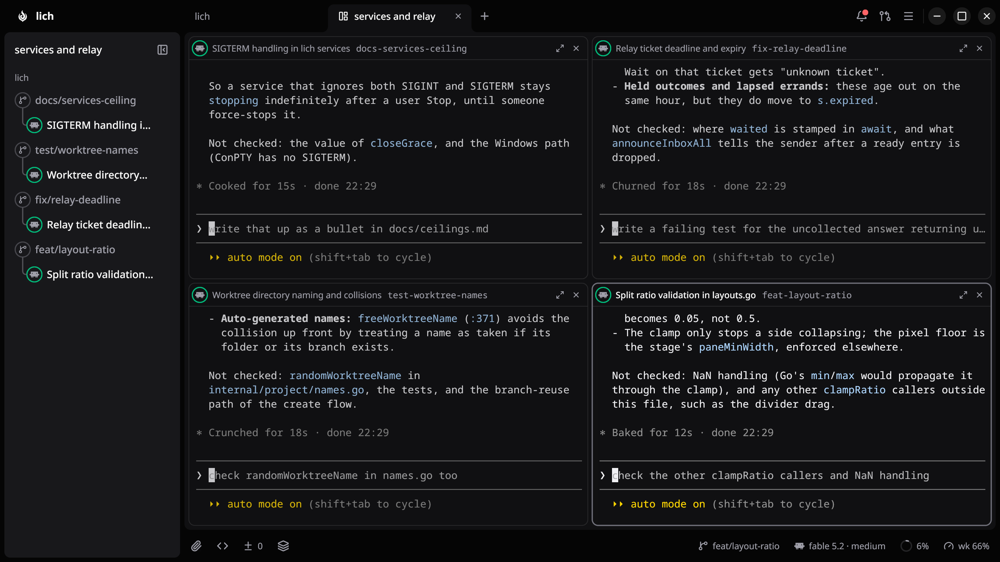
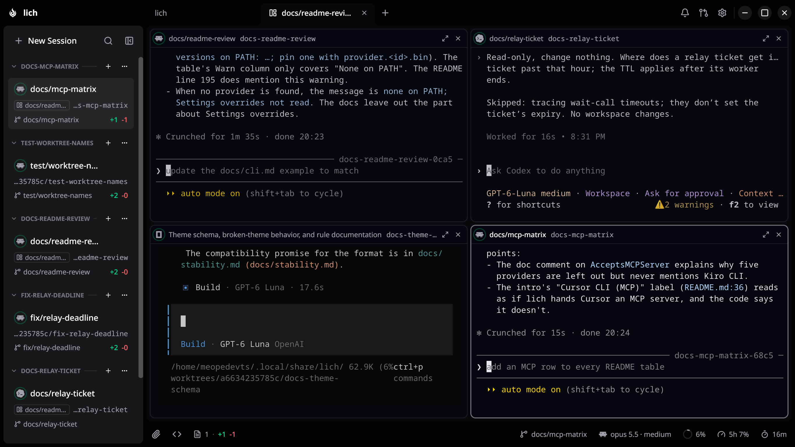
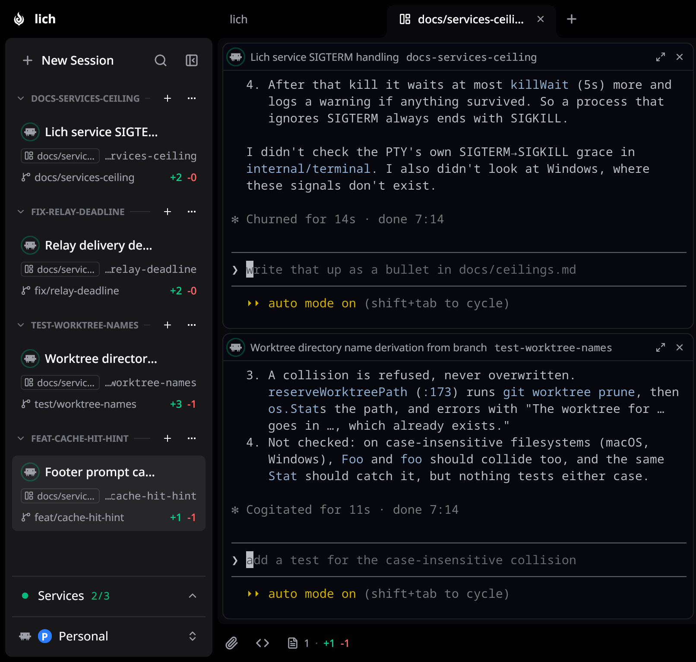
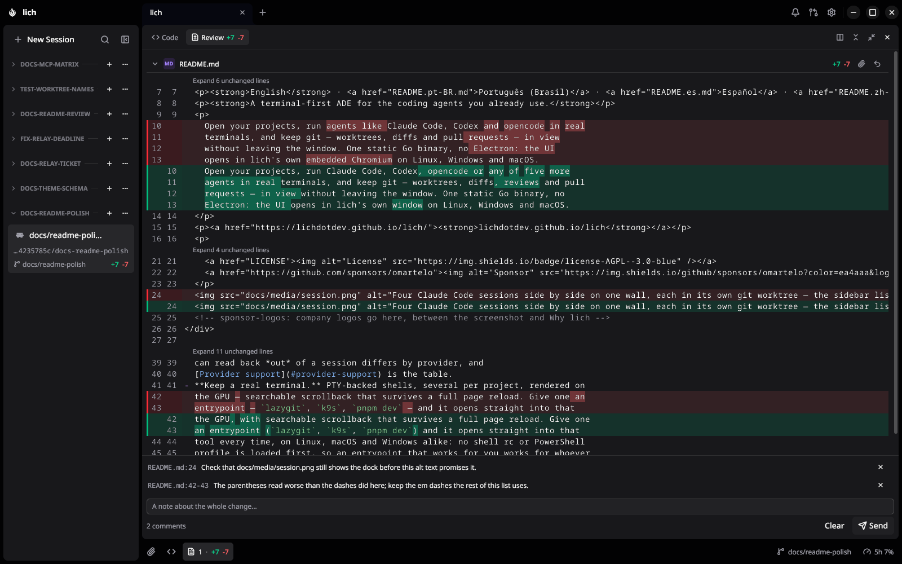
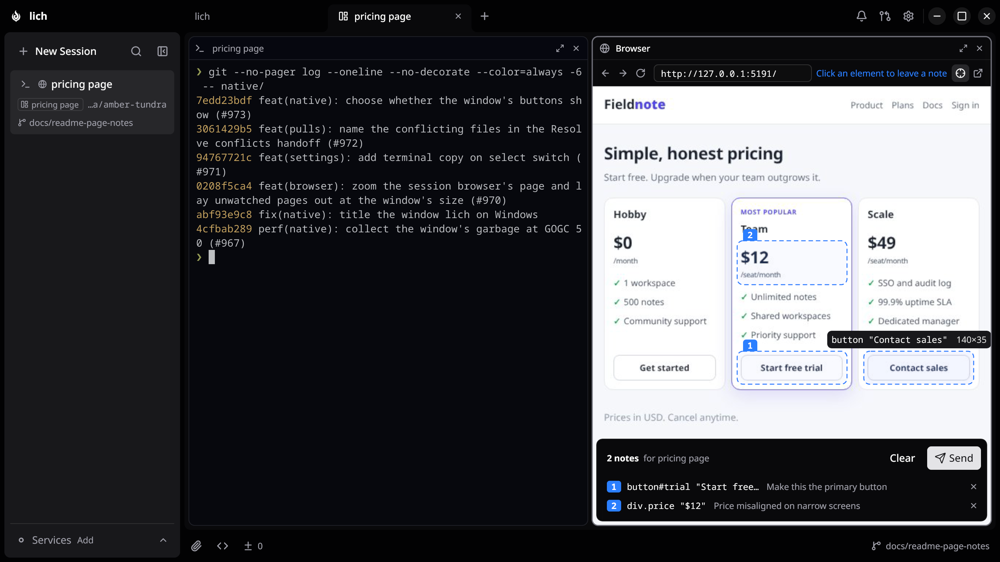
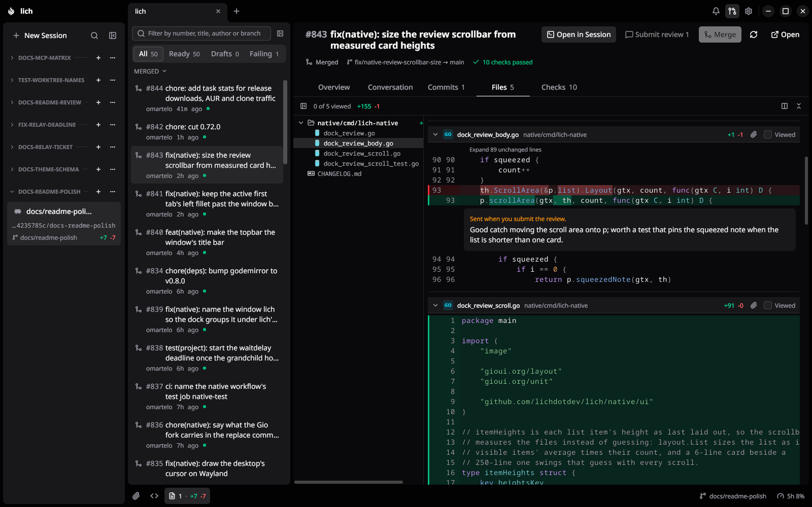
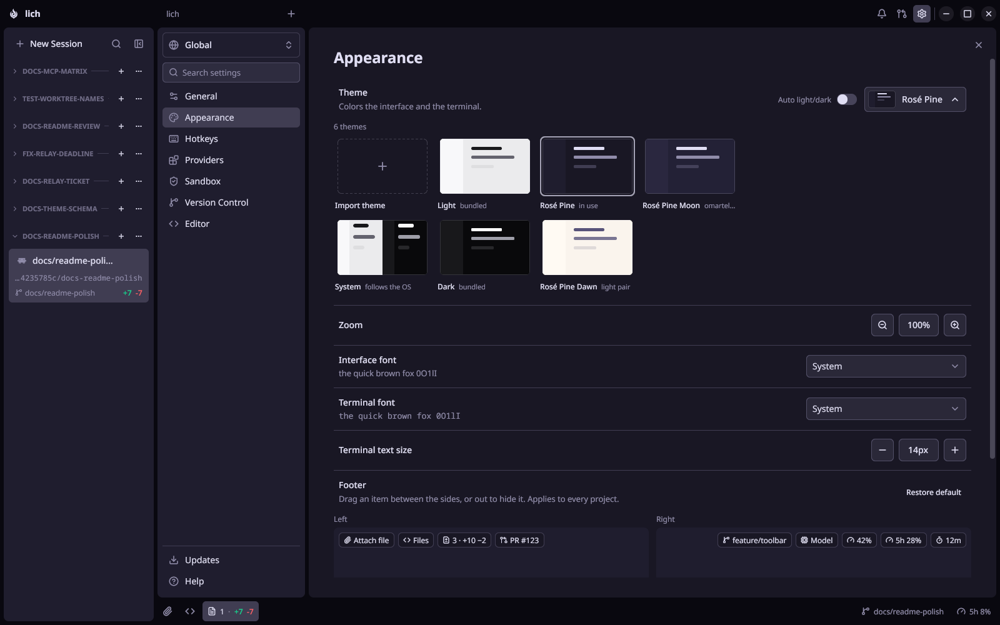

<div align="center">
  
  <h1>lich</h1>
  <p><a href="README.md">English</a> · <strong>Português (Brasil)</strong> · <a href="README.es.md">Español</a> · <a href="README.zh-CN.md">简体中文</a> · <a href="README.ja.md">日本語</a> · <a href="README.ko.md">한국어</a> · <a href="README.ru.md">Русский</a></p>
  <p>
    <a href="https://github.com/lichdotdev/lich/releases"></a>
    
    <a href="LICENSE"></a>
    <a href="https://github.com/sponsors/omartelo"></a>
  </p>
  <p>
    <strong>O ADE multiagente: todos os seus agentes trabalhando ao mesmo tempo, cada um na própria branch.</strong><br/>
    Claude Code, Codex, opencode ou o agente que você já usa, cada um na própria worktree, todos na mesma janela.
  </p>
  <h3><a href="#instalação">Baixar o lich</a> · <a href="https://lichdotdev.github.io/lich/index.pt-BR.html">lichdotdev.github.io/lich</a></h3>
  
  <!-- sponsor-logos: company logos go here, between the screenshot and Features -->
</div>

## Recursos

<table>
<tr>
<td width="50%" valign="middle">

### Agentes lado a lado

Coloque as sessões num split e o lich arruma os painéis sozinho. Veja de relance quem está trabalhando, quem está esperando por você e quanto contexto ainda resta.

</td>
<td width="50%"></td>
</tr>
<tr>
<td width="50%" valign="middle">

### Uma worktree por tarefa, sem configurar nada

Crie uma sessão a partir de qualquer branch e o lich copia seus arquivos `.env` e reserva uma porta livre para o servidor de desenvolvimento. O que você ainda não commitou pode ir junto.

</td>
<td width="50%"></td>
</tr>
<tr>
<td width="50%" valign="middle">

### Revise o diff e comente as linhas

Leia o que o agente mudou ao lado da sessão dele, comente as linhas que precisam de ajuste e mande todas as notas de volta num único prompt.

</td>
<td width="50%"></td>
</tr>
<tr>
<td width="50%" valign="middle">

### Aponte na página, fale com o agente

O agente pilota um navegador ao lado da sessão, e você usa a mesma página. Aponte o que está errado, deixe uma nota em cima e mande todas as notas de volta num prompt só.

</td>
<td width="50%"></td>
</tr>
<tr>
<td width="50%" valign="middle">

### Pull requests sem abrir o navegador

Peça ao agente da branch para abrir o pull request, revise linha a linha e faça o merge, tudo na mesma janela.

</td>
<td width="50%"></td>
</tr>
<tr>
<td width="50%" valign="middle">

### Do seu jeito

Importe um tema em JSON ou instale um direto de um repositório git.

[Docs →](docs/themes.md)

</td>
<td width="50%"></td>
</tr>
</table>

E mais:

- **Sessões que delegam.** Um agente passa uma tarefa para outra sessão e recebe a resposta de volta. O mesmo funciona do seu shell com o comando `lich` ([docs](docs/cli.md)).
- **Agentes em sandbox.** Deixe um agente pular os pedidos de permissão dentro de uma sandbox que não enxerga suas chaves, suas credenciais nem seus outros repositórios ([limites](docs/ceilings.md)).
- **Seus servidores de desenvolvimento na barra lateral.** Salve o que o projeto mantém rodando e ligue ou desligue com um clique.
- **Ache qualquer coisa.** `Ctrl`/`Cmd`+`K` pula para uma sessão pelo nome ou por algo que foi dito nela.
- **Saiba quando precisam de você.** Notificação no desktop quando uma sessão está esperando por você.

## Instalação

```bash
curl -fsSL https://raw.githubusercontent.com/lichdotdev/lich/main/install.sh | sh
```

Um comando só: ele detecta a sua distro, confere o download e instala o lich pelo gerenciador de pacotes.

| Plataforma | Como instalar |
| --- | --- |
| **Linux** | O `install.sh` acima, ou o AUR [`lich-bin`](https://aur.archlinux.org/packages/lich-bin) (`yay -S lich-bin`). Precisa do `zenity` e da glibc 2.34 ou mais nova (Debian 12, Ubuntu 22.04, RHEL 9 em diante). |
| **macOS** | `brew install --cask lichdotdev/tap/lich` |
| **Windows** | Instalador ou zip portátil em [Releases](https://github.com/lichdotdev/lich/releases), ou `scoop install https://github.com/lichdotdev/lich/releases/latest/download/lich.json` |

Os builds de macOS e Windows ainda não são assinados, então o Gatekeeper e o
SmartScreen avisam num download pela página de Releases; pelo Homebrew, o aviso
do Gatekeeper não aparece. Pacotes por distro, o tarball para Linux, como tirar
a flag de quarentena e como atualizar a partir da fórmula antiga do Homebrew
estão no [INSTALL.md](INSTALL.md).

## Primeiros passos

1. **Abra um projeto.** O `+` na barra de abas lista o que você fechou
   recentemente e abre o seletor de pastas. Escolha um repositório git.
2. **Escolha o seu agente.** Na primeira execução, o lich lista os agentes que
   encontrou na máquina. Em Configurações › Provedores você define o padrão e o
   caminho de cada binário.
3. **Inicie uma sessão.** *Nova sessão* abre o seu agente no projeto. O `+` no
   cabeçalho de um checkout abre qualquer agente, ou um terminal comum,
   naquele checkout.
4. **Dê uma worktree para ela** *(opcional)*. Crie uma a partir de qualquer
   branch base e o lich abre uma sessão nova nela.

## Suporte por provedor

Todo agente roda num terminal de verdade, retoma a conversa, funciona na
sandbox e fala com as suas outras sessões. O que muda de um para outro é o que
o lich consegue ler de volta, porque cada CLI registra coisas diferentes.

<details>
<summary>Veja o que cada agente suporta</summary>

| Recurso | Claude Code | Codex | Antigravity | opencode | oh-my-pi | Crush | Cursor CLI | Kiro CLI |
| --- | :-: | :-: | :-: | :-: | :-: | :-: | :-: | :-: |
| Instalar pela tela de boas-vindas | sim | sim | sim | sim; não no Windows | sim | com npm, ou Homebrew no macOS | sim | Linux e macOS |
| Entrar pela tela de boas-vindas | sim | sim | não, na primeira execução | num terminal, com um projeto aberto | num terminal, com um projeto aberto | não, na primeira execução | num terminal, com um projeto aberto; não no macOS | num terminal, com um projeto aberto; só Linux |
| Janela de contexto no rodapé | sim | sim | não | não | não | não | não | sim |
| Quanto do último turno veio do cache de prompt, no rodapé | sim | sim | não | no tooltip de custo | no tooltip de custo | não | não | não |
| Quantos tokens a sessão leu de volta do cache de prompt em todas as chamadas, no tooltip de contexto | sim | não | não | não | não | não | não | não |
| O tooltip do card mostra o modelo em uso, e com qual abriu se ele mudou | sim | sim | não | não | não | não | não | sim |
| Custo no rodapé | sim | sim | não | sim | sim | sim | não | créditos |
| Uma conversa com fork feito dentro do próprio terminal do agente cobra uma vez só o histórico que copia | sim, a não ser quando o custo é o que o próprio Claude Code mediu | não | sem leitura de custo | sim | sim, menos um turno gravado sem id de resposta | não faz fork | sem leitura de custo | sem leitura de custo |
| Quanto ainda resta do seu plano | sim | sim | sim | só OpenCode Go | não | não | sim | não |
| O que você gastou além do plano e o teto disso, no tooltip de uso | sim | não | não | não | não | não | não | não |
| Usar um reset de limite que o seu plano dá, pelo painel do perfil na barra lateral | sim | não | não | não | não | não | não | não |
| Os resets sob demanda que a sua conta tem, no tooltip de uso | não | sim | não | não | não | não | não | não |
| Um turno interrompido pelo limite de uso do plano continua quando o limite renova | sim | sim | não | retenta sozinho | retenta sozinho | não | não | não |
| Se outro perfil seu ainda tem cota, um aviso oferece continuar nele na hora | sim | sim | não | não | não | não | não | não |
| Ao passar o trabalho, um agente pode sugerir um perfil seu para a sucessora, e um aviso deixa você decidir se ela muda | sim | sim | não | não | sim | não | Linux e Windows | só Linux |
| Spinner enquanto o turno roda, anel quando termina | sim | sim | sim | sim | sim | a partir do Crush 0.99.0 | sim | sim |
| O card ganha o nome da conversa | sim | pelo seu primeiro prompt | pelo seu primeiro prompt | sim | sim, a partir do segundo turno | quando o primeiro turno termina, a partir do Crush 0.99.0 | sim, quando o primeiro turno termina | pelo seu primeiro prompt, quando o primeiro turno termina |
| Um pull request aberto pelo agente aparece no card quando o turno termina | sim | sim | sim | sim | sim | a partir do Crush 0.99.0; nas versões anteriores, só quando a janela volta ao foco | sim | sim |
| Uma tarefa que você entrega a um agente volta sozinha quando o turno dele termina | sim | sim | sim | sim | sim | a partir do Crush 0.99.0; nas versões anteriores, ele responde com reply_to_session | no chat; no terminal ele responde com reply_to_session | sim |
| Uma tarefa espera os comandos e subagentes que o agente deixou rodando em segundo plano, em vez de voltar com uma resposta pela metade | no chat; no terminal a partir da próxima versão do lich-plugin | não | não | não | no terminal | não | comandos em segundo plano, no chat | não |
| Se redesenha com o novo visual quando você troca o lich entre tema claro e escuro | sim | não | não | sim | sim | não | sim | não |
| Sino quando o agente depende de você para continuar | sim | sim | não | sim | não | a partir do Crush 0.99.0 | não | não |
| Ctrl+Shift+I pula para a próxima sessão esperando por você | sim | sim | não | sim | não | a partir do Crush 0.99.0 | não | não |
| Um programa no terminal do agente pode definir o card (OSC 7501) enquanto o agente roda | não | não | não | não | não | antes do Crush 0.99.0 | não | não |
| De volta a um shell sem marcas de prompt depois de sair do agente, um programa pode definir o card de novo | sim | não | não | não | não | sim | sim | não |
| A bandeja lista as sessões esperando por você e as que estão trabalhando, e o ícone ganha um ponto | sim | sim | só as que trabalham | sim | só as que trabalham | a partir do Crush 0.99.0 | só as que trabalham | só as que trabalham |
| O card avisa quando a conversa está sendo compactada | no chat | no chat | no chat: só um /compact que você digita | no chat: só um /compact ou /summarize que você digita | no chat: só um /compact que você digita | não | não verificado | no chat |
| Filtro da barra lateral por estado: Aguardando, Rodando, Não lidas | sim | sim | sem Aguardando | sim | sem Aguardando | a partir do Crush 0.99.0; nas versões anteriores, sempre Ociosas | sem Aguardando | sem Aguardando |
| Rodado pelo seu agente dentro de outra sessão (`claude -p`, `cursor-agent -p`), não aparece no card dessa sessão | sim | sim | sim | sim | sim | sim | sim | não |
| Além das ferramentas para falar com as suas outras sessões, o agente é avisado de quando usá-las (passar trabalho para uma sessão na própria worktree) | sim | sim, a não ser que o seu `config.toml` defina `developer_instructions` | sim | sim | sim | sim | não medido | sim |
| Impede a máquina de suspender por inatividade enquanto um turno roda | sim | sim | sim | sim | sim | a partir do Crush 0.99.0 | sim | sim |
| Sessões trocando mensagens sem trabalho entre elas, duas ou num ciclo de várias, são paradas | sim | sim | sim | sim | sim | a partir do Crush 0.99.0 | sim | sim |
| **Último turno** na aba Revisão, com o resumo do agente | sim | sim | sim | sim | sim | não | sim | sim |
| Buscar na conversa pela paleta | sim | sim | sim | sim | sim | sim | não | sim |
| Retomar, pela aba Histórico da paleta, uma conversa iniciada fora do lich | sim | sim | sim | sim | sim | Linux; macOS e Windows sem teste | sim | sim |
| Um paste longo pode entrar como texto editável em vez de um placeholder recolhido (Configurações › Provedores, desligado por padrão) | sim | não | não | sim | não medido | não, vira o anexo `paste_N.txt` | não | sim |
| Fazer fork de uma conversa para uma nova worktree, ou no mesmo checkout | sim | sim | não | sim | não | não | não | não |
| Um agente faz fork da própria conversa (`lich open --fork`); numa worktree nova ele começa no último commit, sem as mudanças não commitadas | sim | sim | não | sim | não | não | não | não |
| Um fork fica pendurado na sessão de origem, na árvore da barra lateral | sim | sim | não | sim | não | não | não | não |
| Aviso quando você retoma, pelo app do próprio agente, uma conversa que já está aberta em outro card | sim | no seu próximo prompt | no seu próximo prompt, sem teste | não | sim | no seu próximo prompt a partir do Crush 0.99.0; nas versões anteriores, na próxima chamada de tool | não | sim |
| Avisado quando edita um arquivo que outra sessão editou minutos antes, e qual sessão foi | sim | sim | sim | sim | sim | a partir do Crush 0.99 | sim | com a sua próxima mensagem |
| Abrir uma sessão com o esforço de raciocínio escolhido | sim | sim | sim | não | sim | não | no nome do modelo | sim |
| Abrir uma sessão com ultracode ligado | sim | não | não | não | não | não | não | não |
| Várias contas lado a lado como perfis, cada uma com login completo próprio, e uma sessão que muda de conta continua no mesmo card (Configurações › Provedores) | sim, com plugins, modelo e esforço padrão próprios em cada perfil e as demais configurações do Pessoal compartilhadas por todos | sim, com plugins, modelo e esforço padrão próprios em cada perfil e as demais configurações do Pessoal compartilhadas por todos | não | sim, com login feito num card de terminal; a sessão não muda de perfil, porque as conversas ficam no mesmo banco que guarda o login; o último modelo escolhido vira o padrão de todos os perfis | sim, com login feito num card de terminal, modelos padrão próprios em cada perfil e as demais configurações compartilhadas por todos os perfis | não medido | Linux e Windows (no macOS o login fica no Keychain), com login feito num card de terminal e `mcp.json`, hooks e skills compartilhados por todos os perfis | só Linux (o macOS guarda o login no Keychain, e no Windows nada consegue mudá-lo de lugar), com login feito num card de terminal e as conversas e o modelo padrão compartilhados por todos os perfis |
| Uma pasta que você marcou como confiável na conta principal abre sem a pergunta "trust this folder?" em todos os outros perfis | sim | sim | sem perfis | não pergunta nada | não pergunta nada | não medido | sim | não pergunta nada |
| Uma sessão na sandbox abre sem a pergunta "trust this folder?" | sim | sim | sim | não pergunta nada | não pergunta nada | sim, e não pede mais para inicializar o projeto | sim | não pergunta nada |
| Uma worktree de uma pasta confiável abre sem a pergunta "trust this folder?" | sim | sim | sim | não pergunta nada | não pergunta nada | sim, e não pede mais para inicializar o projeto | sim | não pergunta nada |
| Controlar uma sessão em chat por `lich control` ou por um agente: prompt, parar, modelo, esforço, compactar, conversa nova, slash command; uma sessão no terminal é recusada | sim | sim; o modelo ou o esforço vale a partir da sua próxima mensagem | sim | sim | sim | sem chat | não verificado | sim, sem esforço, e o modelo só entre um turno e outro |
| Um subagente iniciado pelo agente roda como sessão do lich com card próprio, no checkout da sessão que pediu, entrega o relatório completo e fecha ao terminar; os subagentes dele também ganham card, um nível abaixo | sim | sim | sim | sim | sim | sim | no terminal; o chat dele não roda hooks | sim |
| Contexto, custo e uso do plano medidos pela própria CLI | no chat | não | não | não | não | não | não | não |
| Delegar em privado a partir de um subagente ou etapa de workflow | sim | sim | sim | sim | sim | sim | sim | sim |
| Uma sessão retomada mantém o modelo e o esforço que estava usando | só o modelo | sim | não | modelo | sim | não | modelo | modelo; esforço sem teste |
| Um resultado continua esperando por você mesmo se você interromper a espera | sim | sim | sim | sim | não | sim | sim | sim |
| Uma tarefa passada para outra sessão volta como "sem resposta" assim que aquele agente encerra o turno sem responder | sim | sim | sim | sim | sim | não, espera o prazo | sim | sim |
| As mensagens do próprio lich para o agente (tarefas delegadas, resultados prontos, avisos) no idioma de prompt que você escolher | sim | sim | sim | sim | sim | sim | sim | sim |
| Instruído na criação, no idioma de prompt, a distribuir o trabalho em sessões do lich em vez de subagentes ocultos | sim | não | não | não | sim | não | não | não |
| O card da sessão abre um navegador que o agente dirige, ao lado do terminal da sessão | sim | sim | sim | sim | sim | sim | sim | sim |
| Uma página que o agente faz para te mostrar (um relatório, um diagrama, um mockup) abre nesse navegador a partir de uma pasta própria da sessão, fora do checkout, mantida enquanto a sessão existir | sim, mas o Claude Code ainda pode publicá-la no claude.ai com a própria ferramenta Artifact | sim | sim | sim | sim | sim | sim | sim |
| Uma skill para escrever uma extensão do lich, que só roda quando você chama (`/lich:extension`) | sim | sim, como `$lich:extension` | sim, mas o agente a vê em todo turno: o Antigravity não consegue deixar uma skill só para uso manual | sim, como `/lich-extension` (opencode 1) ou pelo `/skills` (opencode 2) | sim, como `/skill:lich-extension` | sim, pela paleta de comandos | sim, mas o agente a vê em todo turno: o Cursor mostra ao agente toda skill de um plugin | não: o Kiro não consegue tirar uma skill do contexto do agente |
| A sessão pode aparecer como chat em vez do terminal, alternando entre os dois na mesma conversa | sim | sim | sim | sim | sim | não | não verificado | sim |
| Uma sessão nova abre como chat, ou no terminal quando Configurações › Provedores pede | sim | sim | sim | sim | sim | não, sempre no terminal | não verificado | sim |
| Uma sessão em chat recebe as tarefas e os avisos que outras sessões mandam | sim | sim; responder com as ferramentas do lich pelo chat não verificado | sim; responder com as ferramentas do lich pelo chat não verificado | sim; responder com as ferramentas do lich pelo chat não verificado | sim; responder com as ferramentas do lich pelo chat não verificado | sem chat | não verificado | sim; responder com as ferramentas do lich pelo chat não verificado |
| No chat, escolher o modelo, o esforço e o modo que o agente oferece | sim, inclusive um modo que roda toda ferramenta sem perguntar | sim, inclusive um modo que roda todas as ferramentas sem perguntar; a mudança vale a partir da sua próxima mensagem | sim | sim | sim | não | não verificado | modelo e modo, sem esforço |
| Settings › Providers define o modelo e o esforço com que um chat novo começa, para cada perfil e cada projeto, entre o que o último chat do agente ofereceu; um terminal segue a configuração do próprio agente | sim | sim | sim, por projeto: não tem perfis | sim | sim | sem chat | não verificado | só o modelo |
| No chat, uma permissão que o agente marca para nenhuma tecla solta aprovar sugere Negar e não aceita tecla de número | sim | não: ele nunca marca | não: ele nunca marca | não: ele nunca marca | não: ele nunca marca | sem chat | não: ele nunca marca | não: ele nunca marca |
| No chat, as perguntas do agente chegam num cartão que você responde com clique ou tecla | sim | não verificado | sim | sim no opencode 1; opencode 2 não verificado | sim | não | não verificado | não: o Kiro pergunta em texto |
| No chat, um plano que o agente pede para começar chega num cartão com o plano, para começar aceitando todas as edições ou aprovando cada uma, ou continuar planejando dizendo o que mudar | sim; as opções do terminal de limpar o contexto, ignorar permissões, modo auto e Ultraplan não aparecem | não: o chat não tem modo plano | não verificado | não verificado; o opencode pergunta com a própria pergunta, que chega como cartão de pergunta | não verificado | sem chat | não verificado | não verificado |
| No chat, digitar / no começo de uma linha lista os comandos e as skills do agente para completar | sim, com as skills marcadas | só skills, digitadas como `$nome` | sim | sim | sim | não | não verificado | sim |
| No chat, digitar @ no começo de uma palavra lista os arquivos e as pastas do projeto, para pôr um caminho na mensagem | sim; o Claude Code lê o arquivo sozinho | sim; o caminho vai como texto e o agente abre com as próprias ferramentas | sim; o caminho vai como texto, o que o agente faz com ele não verificado | sim; o caminho vai como texto, o que o agente faz com ele não verificado | sim; o caminho vai como texto, o que o agente faz com ele não verificado | não | não verificado | sim; o caminho vai como texto, o que o agente faz com ele não verificado |
| No chat, uma linha que começa com ! roda como comando de shell no projeto, sem o agente e sem pedir permissão | sim; o agente recebe a saída e responde, como no ! do próprio Claude Code | sim; o agente vê junto com a sua próxima mensagem, e o chat não mostra depois de reiniciar | não: a linha vai para o agente como foi digitada | sim no opencode 1, e o agente vê; o opencode 2 manda a linha como foi digitada | não: a linha vai para o agente como foi digitada | não | não: a linha vai para o agente como foi digitada | não: a linha vai para o agente como foi digitada |
| No chat, uma compactação aparece enquanto roda e deixa uma linha com os tokens de antes e de depois | sim | sim | só um /compact que você digita | só um /compact ou /summarize que você digita | só um /compact que você digita | não | não verificado | sim, sem a contagem de tokens |
| No chat, Shift+Tab passa para o próximo modo que o agente oferece, nunca para um que roda toda ferramenta sem perguntar | sim, na ordem do próprio Claude Code | sim | sim | sim | sim | não | não verificado | sim |
| No chat, /mcp lista os servidores MCP do agente com as ferramentas de cada um, para desligar ou ligar, reconectar ou fazer login, e /skills lista as skills para ligar ou desligar | sim; uma skill que você desliga fica gravada no `.claude/settings.local.json` do checkout | sim; num perfil que não é o da sua conta principal, a mudança se desfaz na próxima vez que uma sessão abre nele | não | não | não | não | não | não |
| No chat, /plugin lista os plugins do agente para instalar, atualizar, desligar ou desinstalar, e os marketplaces para adicionar, atualizar ou remover | sim; uma atualização vale quando o chat reinicia | sim; instala só para você, a partir dos marketplaces da sua máquina, e não atualiza plugin | não | não | não | não | não | não |
| O plugin do lich roda em toda sessão que o lich abre, mesmo desligado ou removido na config do próprio agente | sim | volta a ser ligado quando cada sessão abre; uma sessão já aberta recebe na próxima conversa | volta a ser ligado quando cada sessão abre | sim | sim | não tem como desligar; se as linhas dele saírem do crushrc, o lich escreve de novo | sim | não tem como desligar; se o agente do lich for apagado, o lich escreve de novo |
| Skills e servidores MCP da biblioteca do lich (Configurações › Skills, Servidores MCP), ligados ou desligados por provedor e por perfil | sim, por sessão | skills gravadas na pasta de skills dele, uma chave para todos os perfis; servidores MCP por sessão | skills gravadas na pasta de skills dele; servidores MCP ainda não | sim, por sessão | skills por sessão; servidores MCP gravados no mcp.json dele, uma chave para todos os perfis | skills por sessão, exceto no Windows; servidores MCP ainda não | skills por sessão; servidores MCP gravados no ~/.cursor/mcp.json, uma chave para todos os perfis | skills gravadas na pasta de skills dele, uma chave para todos os perfis; servidores MCP ainda não |
| Uma skill ou servidor MCP instalado no provedor aparece nas Configurações para mover para a biblioteca do lich, desligado onde estava, nunca apagado | sim; os servidores MCP pela própria CLI, exceto um que envia cabeçalhos próprios | sim; os servidores MCP pela própria CLI, exceto um que envia cabeçalhos próprios | sim | sim | sim | sim | sim | sim |
| Os servidores MCP do próprio projeto aparecem em Configurações › Servidores MCP desse projeto, nunca movidos | sim, .mcp.json e o escopo local | sim, .codex/config.toml | não | sim, opencode.json | não, ainda não lidos | sim, crush.json | sim, .cursor/mcp.json | sim, .kiro/settings/mcp.json |
| Configurações › Plugins lista os plugins que o provedor carrega e liga ou desliga cada um | sim, por perfil; num projeto, gravado em .claude/settings.local.json | sim, por perfil | sim | listados, sem chave: o opencode só desliga um removendo-o | sim, uma chave para todos os perfis | não: não aceita plugins | carrega os do Claude Code, que aparecem lá | não: não aceita plugins |
| No chat, /permissions lista as regras de permitir, perguntar e negar do agente e as pastas em que ele pode trabalhar, para adicionar uma regra a um arquivo de configuração ou remover uma | sim; as pastas aparecem, mas não se adicionam nem removem | lista os modos para escolher um, já que o Codex não tem regras | não | não | não | não | não | não |
| No chat, /hooks lista os hooks do agente por evento | sim; só para ler, como no /hooks dele | sim; para confiar num hook, ou desligar e ligar | não | não | não | não | não | não |
| No chat, /memory lista os arquivos de instruções que o agente carrega e as memórias que ele salvou, para abrir e editar, e liga ou desliga a memória automática; /agents lista os subagentes, para abrir o arquivo de um ou adicionar outro | sim | sim; /memory lista os AGENTS.md que a conversa carregou e /agents os papéis que o seu `config.toml` declara, sem os nativos e sem como adicionar um | não | não | não | não | não | não |
| No chat, a chamada de ferramenta aparece assim que começa, com o tempo correndo, e guarda quanto durou | sim | sim; uma conversa relida não mostra tempos | não verificado | não verificado | não verificado | não | não verificado | não verificado |
| No chat, a mensagem escrita enquanto o agente trabalha espera numa fila que entra no turno quando o agente começa a próxima ferramenta, ou quando o turno termina, ou é forçada dentro do turno em andamento | sim | sim | na fila; forçar para o turno e manda depois | na fila; forçar para o turno e manda depois | na fila; forçar para o turno e manda depois | não | não verificado | na fila; forçar para o turno e manda depois |
| No chat, a lista de tarefas do agente fica sobre a caixa de mensagem enquanto falta alguma tarefa | sim; um `CLAUDE_CODE_ENABLE_TODO_TOOLS` que você exporta é mantido, e com 0 a lista some nos modelos Claude 5 | sim; uma conversa retomada mostra a lista quando o agente a atualiza | não verificado | não verificado | sim | sem chat | não verificado | não verificado |
| No chat, um chip na caixa de mensagem conta os comandos que o agente deixou rodando em segundo plano e os abre para ler a saída e parar um | sim; eles param com o processo do chat, ao trocar para TUI, no /new ou ao passar para o modo YOLO | não | não | não | não | sem chat | não | não |
| No chat, Ctrl+B manda para segundo plano um comando que o agente está esperando, que segue rodando enquanto o agente continua | sim; a linha que mostra o agente trabalhando avisa quando dá | não | não | não | não | sem chat | não | não |
| No chat, um workflow que o agente deixou rodando fica sobre a caixa de mensagem, com quantos agentes já terminaram e quais estão rodando, e abre para mostrar cada agente | sim; só para acompanhar, e ele termina junto com o processo do chat | não | não | não | não | sem chat | não | não |
| No chat, a imagem que você anexa chega ao agente como imagem, e qualquer outro arquivo como o caminho dele na mensagem | sim | vai como imagem; não verificado se o agente a vê | vai como imagem; não verificado se o agente a vê | vai como imagem; não verificado se o agente a vê | vai como imagem; não verificado se o agente a vê | não | não verificado | vai como imagem; não verificado se o agente a vê |
| No chat, quando um turno que você começou termina, a caixa de mensagem vazia sugere o que você escreveria em seguida, e Tab põe a sugestão na caixa | sim | sim; o lich pergunta ao mesmo modelo com esforço baixo, o que gasta um pouco do seu plano | não | não | não | sem chat | não | não |
| No chat, quando sua primeira mensagem é respondida, a sessão ganha nome a partir dela, com uma chamada ao mesmo agente com esforço baixo, o que gasta um pouco do seu plano | sim | sim; não verificado em conta real | não: deixaria uma conversa no histórico dele | sim; só opencode 1, e a sessão descartável é apagada | sim; não verificado em conta real | sem chat | não: deixaria um chat no histórico e mudaria seu modelo padrão | não: deixaria uma conversa no histórico dele |

</details>

Toda lacuna é proposital, e o [`docs/ceilings.md`](docs/ceilings.md) diz o que
foi medido em cada uma.

## Configuração

- **Provedores.** Em Configurações › Provedores você define o binário de cada
  agente e o padrão de todos os projetos; um projeto pode escolher o dele. Sem
  caminho definido, o lich roda o primeiro binário do `PATH` do seu shell de
  login, e o `lich doctor` avisa quando há mais de uma versão.
- **Rodapé.** Em Configurações › Aparência, arraste os itens para escolher o que
  ele mostra. O custo começa oculto, porque só faz sentido se você paga por
  token.
- **Worktrees.** Um arquivo `.worktreeinclude` no projeto escolhe quais arquivos
  ignorados pelo git vão para cada worktree nova.
- **Hooks de sessão.** Instale o [plugin do lich](https://github.com/lichdotdev/lich-plugin)
  pelas Configurações e a sessão dá nome ao próprio card e atualiza o git assim
  que grava um arquivo.
- **Scripts.** O [docs/stability.md](docs/stability.md) diz quais partes do lich
  são seguras para usar em scripts.

## Privacidade e atualizações

Tudo roda na sua máquina: sem conta, sem login, sem telemetria. O lich só acessa
a rede para:

- **Atualizações**: verificação de versão no GitHub Releases ao iniciar e a
  cada hora, e a lista de releases do plugin do lich ao iniciar.
- **Uso do plano**: o endpoint de uso de cada provedor (Anthropic, OpenAI,
  Cursor, OpenCode Go), com o login que o agente já usa, no máximo a cada cinco
  minutos. O plano do Antigravity é lido do próprio `agy`.
- **Preços**: a tabela pública de preços do LiteLLM no GitHub, uma vez, quando
  a tabela embutida não conhece o modelo.

O instalador do Windows se atualiza sozinho; Homebrew, Scoop, AUR e os pacotes
Linux atualizam pelo gerenciador de pacotes, e o lich mostra o comando.
Algo quebrou? O `lich doctor` confere a sua instalação e o `lich rage` junta um
bug report num único arquivo, sem enviar nada. Configurações › Ajuda mostra o
que vai no log (caminhos, nomes de projeto e de branch, seu login do gh, nunca
um token de sessão) antes de você anexá-lo. Bugs e pedidos vão nas
[Issues](https://github.com/lichdotdev/lich/issues); o que mudou em cada versão
está no [CHANGELOG.md](CHANGELOG.md).

## Compilar a partir do código-fonte

O lich são dois binários: o `lich`, um backend estático em Go puro, e o
`lich-native`, a janela, compilada com cgo a partir de `native/`. Você precisa
de **Go 1.27.0+** e do **[Task](https://taskfile.dev)**; a janela pede também um
toolchain C, os pacotes de sistema do Gio, a `libturbojpeg` do libjpeg-turbo e
uma `libghostty-vt` compilada a
partir do commit em `native/GHOSTTY_COMMIT`. O [`native/slice.sh`](native/slice.sh)
explica como, e o [`docs/native-window.md`](docs/native-window.md) descreve a
janela.

```bash
task build          # binário do backend -> bin/lich
task build:native   # janela -> bin/lich-native
task run            # compila + roda
task test           # suítes Go
task package        # .deb + .rpm + Arch .pkg.tar.zst em bin/ (precisa do nfpm)
```

Adicionar outro agente mexe em uma dúzia de arquivos de dois repositórios, e o
mapa está em [`docs/adding-a-provider.md`](docs/adding-a-provider.md).

## Patrocinadores

O lich é escrito e mantido por uma pessoa só. O patrocínio paga o tempo
investido nele e mantém o projeto independente: o app não tem plano pago e não
vai ter.

[**Patrocine o lich**](https://github.com/sponsors/omartelo)

<!-- sponsor-names: monthly sponsors go here -->

### Apoiadores

<!-- backers: one-time supporters go here -->

Ainda ninguém.

## Licença

[AGPL-3.0-only](LICENSE) © 2026 omartelo

O lich é software livre: você pode usar, estudar, modificar e redistribuir o
lich nos termos da GNU Affero General Public License v3. Qualquer derivado
distribuído ou disponibilizado pela rede precisa ser publicado sob a mesma
licença. As versões até a v0.9.0, inclusive, continuam sob licença MIT.
