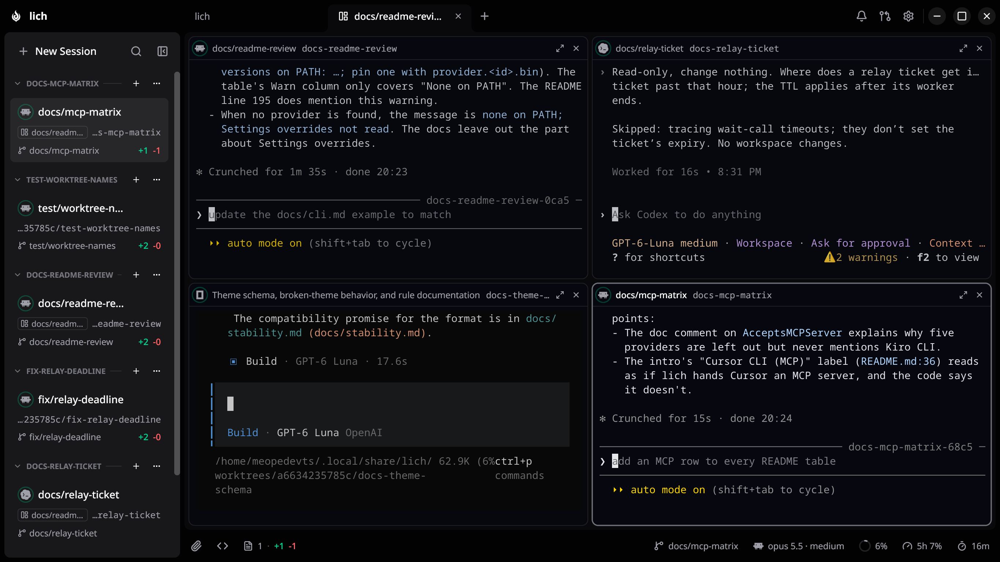
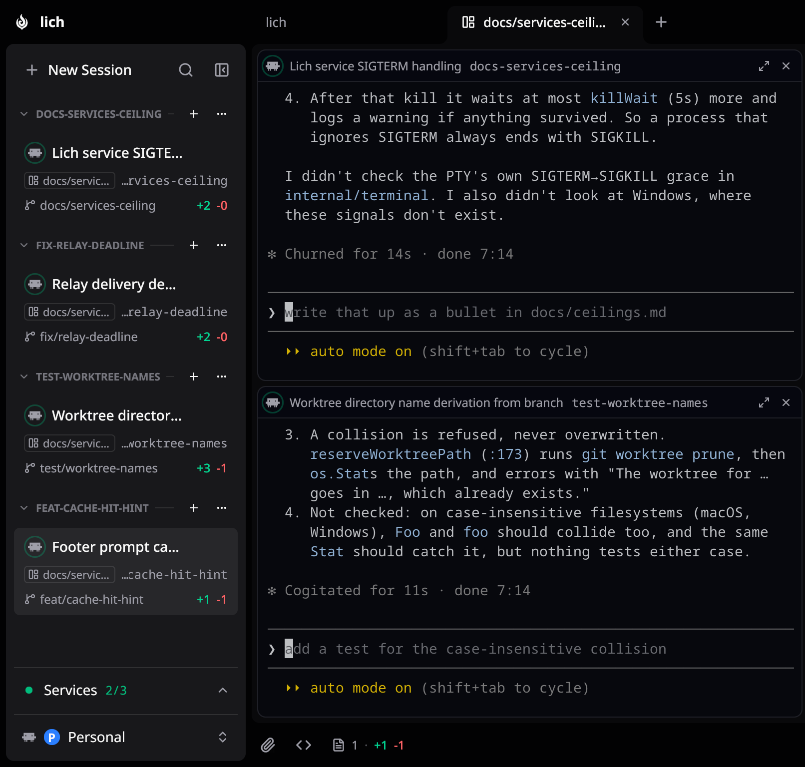
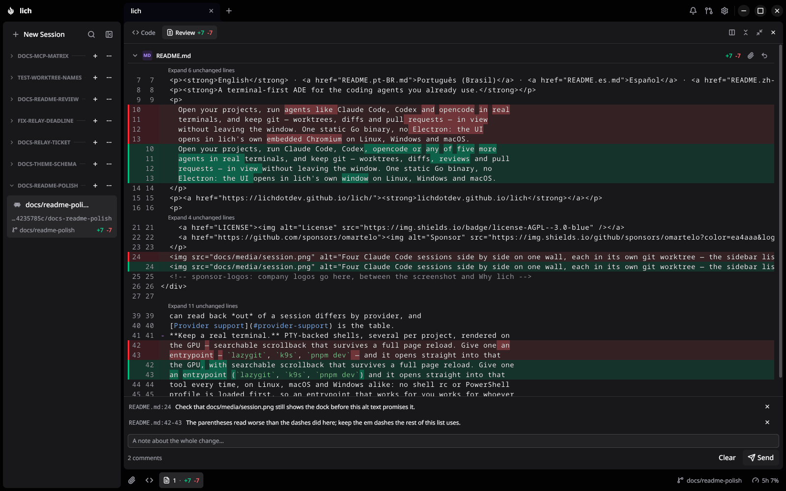
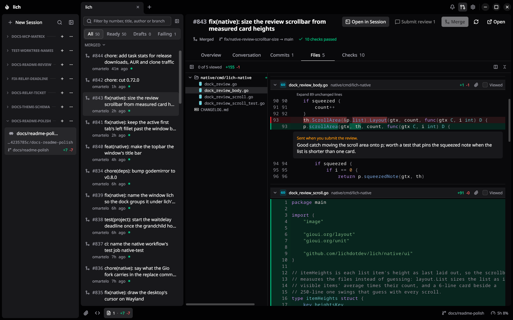
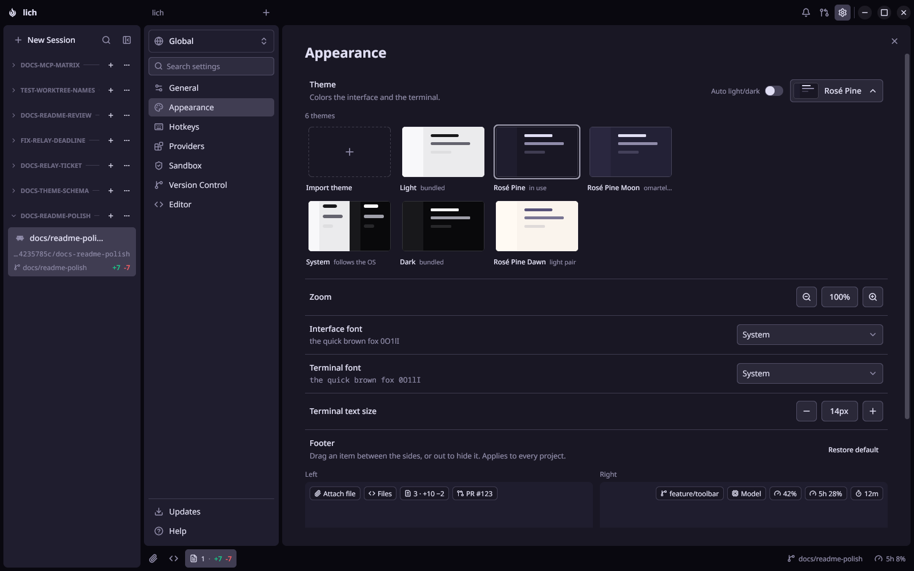

<div align="center">
  
  <h1>lich</h1>
  <p><a href="README.md">English</a> · <strong>Português (Brasil)</strong> · <a href="README.es.md">Español</a> · <a href="README.zh-CN.md">简体中文</a> · <a href="README.ja.md">日本語</a> · <a href="README.ko.md">한국어</a> · <a href="README.ru.md">Русский</a></p>
  <p>
    <a href="https://github.com/lichdotdev/lich/releases"></a>
    
    <a href="LICENSE"></a>
    <a href="https://github.com/sponsors/omartelo"></a>
  </p>
  <p>
    <strong>Seus agentes de código lado a lado, cada um na própria branch.</strong><br/>
    Claude Code, Codex, opencode ou o agente que você já usa, cada um na própria worktree, todos na mesma janela.
  </p>
  <h3><a href="#instalação">Baixar o lich</a> · <a href="https://lichdotdev.github.io/lich/index.pt-BR.html">lichdotdev.github.io/lich</a></h3>
  
  <!-- sponsor-logos: company logos go here, between the screenshot and Features -->
</div>

## Recursos

<table>
<tr>
<td width="50%" valign="middle">

### Agentes lado a lado

Coloque as sessões num split e o lich arruma os painéis sozinho. Veja de relance quem está trabalhando, quem está esperando por você e quanto contexto ainda resta.

</td>
<td width="50%"></td>
</tr>
<tr>
<td width="50%" valign="middle">

### Uma worktree por tarefa, sem configurar nada

Crie uma sessão a partir de qualquer branch e o lich copia seus arquivos `.env` e reserva uma porta livre para o servidor de desenvolvimento. O que você ainda não commitou pode ir junto.

</td>
<td width="50%"></td>
</tr>
<tr>
<td width="50%" valign="middle">

### Revise o diff e comente as linhas

Leia o que o agente mudou ao lado da sessão dele, comente as linhas que precisam de ajuste e mande todas as notas de volta num único prompt.

</td>
<td width="50%"></td>
</tr>
<tr>
<td width="50%" valign="middle">

### Pull requests sem abrir o navegador

Peça ao agente da branch para abrir o pull request, revise linha a linha e faça o merge, tudo na mesma janela.

</td>
<td width="50%"></td>
</tr>
<tr>
<td width="50%" valign="middle">

### Do seu jeito

Importe um tema em JSON ou instale um direto de um repositório git.

[Docs →](docs/themes.md)

</td>
<td width="50%"></td>
</tr>
</table>

E mais:

- **Sessões que delegam.** Um agente passa uma tarefa para outra sessão e recebe a resposta de volta. O mesmo funciona do seu shell com o comando `lich` ([docs](docs/cli.md)).
- **Agentes em sandbox.** Deixe um agente pular os pedidos de permissão dentro de uma sandbox que não enxerga suas chaves, suas credenciais nem seus outros repositórios ([limites](docs/ceilings.md)).
- **Seus servidores de desenvolvimento na barra lateral.** Salve o que o projeto mantém rodando e ligue ou desligue com um clique.
- **Ache qualquer coisa.** `Ctrl`/`Cmd`+`K` pula para uma sessão pelo nome ou por algo que foi dito nela.
- **Saiba quando precisam de você.** Notificação no desktop quando uma sessão está esperando por você.

## Instalação

```bash
curl -fsSL https://raw.githubusercontent.com/lichdotdev/lich/main/install.sh | sh
```

Um comando só: ele detecta a sua distro, confere o download e instala o lich pelo gerenciador de pacotes.

| Plataforma | Como instalar |
| --- | --- |
| **Linux** | O `install.sh` acima, ou o AUR [`lich-bin`](https://aur.archlinux.org/packages/lich-bin) (`yay -S lich-bin`). Precisa do `zenity` e da glibc 2.34 ou mais nova (Debian 12, Ubuntu 22.04, RHEL 9 em diante). |
| **macOS** | `brew install --cask lichdotdev/tap/lich` |
| **Windows** | Instalador ou zip portátil em [Releases](https://github.com/lichdotdev/lich/releases), ou `scoop install https://github.com/lichdotdev/lich/releases/latest/download/lich.json` |

Os builds de macOS e Windows ainda não são assinados, então o Gatekeeper e o
SmartScreen avisam num download pela página de Releases; pelo Homebrew, o aviso
do Gatekeeper não aparece. Pacotes por distro, o tarball para Linux, como tirar
a flag de quarentena e como atualizar a partir da fórmula antiga do Homebrew
estão no [INSTALL.md](INSTALL.md).

## Primeiros passos

1. **Abra um projeto.** O `+` na barra de abas lista o que você fechou
   recentemente e abre o seletor de pastas. Escolha um repositório git.
2. **Escolha o seu agente.** Na primeira execução, o lich lista os agentes que
   encontrou na máquina. Em Configurações › Provedores você define o padrão e o
   caminho de cada binário.
3. **Inicie uma sessão.** *Nova sessão* abre o seu agente no projeto. O `+` no
   cabeçalho de um checkout abre qualquer agente, ou um terminal comum,
   naquele checkout.
4. **Dê uma worktree para ela** *(opcional)*. Crie uma a partir de qualquer
   branch base e o lich abre uma sessão nova nela.

## Suporte por provedor

Todo agente roda num terminal de verdade, retoma a conversa, funciona na
sandbox e fala com as suas outras sessões. O que muda de um para outro é o que
o lich consegue ler de volta, porque cada CLI registra coisas diferentes.

<details>
<summary>Veja o que cada agente suporta</summary>

| Recurso | Claude Code | Codex | Antigravity | opencode | oh-my-pi | Crush | Cursor CLI | Kiro CLI |
| --- | :-: | :-: | :-: | :-: | :-: | :-: | :-: | :-: |
| Janela de contexto no rodapé | sim | sim | não | não | não | não | não | sim |
| Quanto do último turno veio do cache de prompt, no rodapé | sim | sim | não | no tooltip de custo | no tooltip de custo | não | não | não |
| O tooltip do card mostra o modelo em uso, e com qual abriu se ele mudou | sim | sim | não | não | não | não | não | sim |
| Custo no rodapé | sim | sim | não | sim | sim | sim | não | créditos |
| Quanto ainda resta do seu plano | sim | sim | sim | só OpenCode Go | não | não | sim | não |
| Um turno interrompido pelo limite de uso do plano continua quando o limite renova | sim | sim | não | retenta sozinho | retenta sozinho | não | não | não |
| Spinner enquanto o turno roda, anel quando termina | sim | sim | sim | sim | sim | não | sim | sim |
| O card ganha o nome da conversa | sim | pelo seu primeiro prompt | pelo seu primeiro prompt | sim | sim, a partir do segundo turno | não | sim, quando o primeiro turno termina | pelo seu primeiro prompt, quando o primeiro turno termina |
| Um pull request aberto pelo agente aparece no card quando o turno termina | sim | sim | sim | sim | sim | não, só quando a janela volta ao foco | sim | sim |
| Se redesenha com o novo visual quando você troca o lich entre tema claro e escuro | sim | não | não | sim | sim | não | sim | não |
| Sino quando o agente depende de você para continuar | sim | sim | não | sim | não | não | não | não |
| Ctrl+Shift+Y pula para a próxima sessão esperando por você | sim | sim | não | sim | não | não | não | não |
| O card avisa quando a conversa está sendo compactada | sim | não | não | não | não | não | não | não |
| Filtro da barra lateral por estado: Aguardando, Rodando, Não lidas | sim | sim | sem Aguardando | sim | sem Aguardando | não, sempre Ociosas | sem Aguardando | sem Aguardando |
| Rodado pelo seu agente dentro de outra sessão (`claude -p`, `cursor-agent -p`), não aparece no card dessa sessão | sim | sim | sim | sim | sim | sim | sim | não |
| Impede a máquina de suspender por inatividade enquanto um turno roda | sim | sim | sim | sim | sim | não | sim | sim |
| **Último turno** na aba Revisão, com o resumo do agente | sim | sim | sim | sim | sim | não | sim | sim |
| Buscar na conversa pela paleta | sim | sim | sim | sim | sim | sim | não | sim |
| Retomar, pela aba Histórico da paleta, uma conversa iniciada fora do lich | sim | sim | sim | sim | sim | Linux; macOS e Windows sem teste | sim | sim |
| Um paste longo pode entrar como texto editável em vez de um placeholder recolhido (Configurações › Provedores, desligado por padrão) | sim | não | não | sim | não medido | não, vira o anexo `paste_N.txt` | não | sim |
| Fazer fork de uma conversa para uma nova worktree, ou no mesmo checkout | sim | sim | não | sim | não | não | não | não |
| Aviso quando você retoma, pelo app do próprio agente, uma conversa que já está aberta em outro card | sim | no seu próximo prompt | no seu próximo prompt, sem teste | não | sim | na próxima chamada de tool | não | sim |
| Abrir uma sessão com o esforço de raciocínio escolhido | sim | sim | sim | não | sim | não | no nome do modelo | sim |
| Abrir uma sessão com ultracode ligado | sim | não | não | não | não | não | não | não |
| Várias contas lado a lado como perfis, cada uma com login completo próprio, e uma sessão que muda de conta continua no mesmo card (Configurações › Provedores) | sim | sim, com plugins próprios em cada perfil e as configurações do Pessoal compartilhadas por todos | não | sim, com login feito num card de terminal; a sessão não muda de perfil, porque as conversas ficam no mesmo banco que guarda o login | sim, com login feito num card de terminal e configurações compartilhadas por todos os perfis | não medido | Linux e Windows (no macOS o login fica no Keychain), com login feito num card de terminal e `mcp.json`, hooks e skills compartilhados por todos os perfis | só Linux (o macOS guarda o login no Keychain, e no Windows nada consegue mudá-lo de lugar), com login feito num card de terminal e as conversas compartilhadas por todos os perfis |
| Uma pasta que você marcou como confiável na conta principal abre sem a pergunta "trust this folder?" em todos os outros perfis | sim | sim | sem perfis | não pergunta nada | não pergunta nada | não medido | sim | não pergunta nada |
| Uma sessão na sandbox abre sem a pergunta "trust this folder?" | sim | sim | sim | não pergunta nada | não pergunta nada | sim, e não pede mais para inicializar o projeto | sim | não pergunta nada |
| Uma worktree de uma pasta confiável abre sem a pergunta "trust this folder?" | sim | sim | sim | não pergunta nada | não pergunta nada | sim, e não pede mais para inicializar o projeto | sim | não pergunta nada |
| Controlar uma sessão em execução por `lich control` ou por um agente: prompt, parar, modelo, esforço, slash command | sim | não | não | não | não | não | não | não |
| Uma mensagem de outra sessão chega sem ser digitada no terminal | sim | não | não | não | não | não | não | não |
| Um subagente iniciado pelo agente roda como sessão do lich com card próprio, no checkout da sessão que pediu, entrega o relatório completo e fecha ao terminar; os subagentes dele também ganham card, um nível abaixo | sim | não | não | não | não | não | não | não |
| Fazer uma pergunta paralela a uma sessão em execução sem interromper (`lich ask`) | sim | não | não | não | não | não | não | não |
| Contexto, custo e uso do plano medidos pela própria CLI | sim | não | não | não | não | não | não | não |
| A status line do terminal mostra a quem a sessão deve resposta, de quem ela está esperando e as respostas prontas para coletar | sim | não | não | não | não | não | não | não |
| Delegar em privado a partir de um subagente ou etapa de workflow | sim | sim | sim | sim | sim | sim | sim | sim |
| Uma sessão retomada mantém o modelo e o esforço que estava usando | só o modelo | sim | não | modelo | sim | não | modelo | modelo; esforço sem teste |
| Um resultado continua esperando por você mesmo se você interromper a espera | sim | sim | sim | sim | não | sim | sim | sim |
| Uma tarefa passada para outra sessão volta como "sem resposta" assim que aquele agente encerra o turno sem responder | sim | sim | sim | sim | sim | não, espera o prazo | sim | sim |
| As mensagens do próprio lich para o agente (tarefas delegadas, resultados prontos, avisos) no idioma de prompt que você escolher | sim | sim | sim | sim | sim | sim | sim | sim |
| Instruído na criação, no idioma de prompt, a distribuir o trabalho em sessões do lich em vez de subagentes ocultos | sim | não | não | não | sim | não | não | não |
| O card da sessão abre um navegador que o agente dirige, numa aba ao lado da sessão | sim | sim | sim | sim | sim | sim | sim | sim |

</details>

Toda lacuna é proposital, e o [`docs/ceilings.md`](docs/ceilings.md) diz o que
foi medido em cada uma.

## Configuração

- **Provedores.** Em Configurações › Provedores você define o binário de cada
  agente e o padrão de todos os projetos; um projeto pode escolher o dele. Sem
  caminho definido, o lich roda o primeiro binário do `PATH` do seu shell de
  login, e o `lich doctor` avisa quando há mais de uma versão.
- **Rodapé.** Em Configurações › Aparência, arraste os itens para escolher o que
  ele mostra. O custo começa oculto, porque só faz sentido se você paga por
  token.
- **Worktrees.** Um arquivo `.worktreeinclude` no projeto escolhe quais arquivos
  ignorados pelo git vão para cada worktree nova.
- **Hooks de sessão.** Instale o [plugin do lich](https://github.com/lichdotdev/lich-plugin)
  pelas Configurações e a sessão dá nome ao próprio card e atualiza o git assim
  que grava um arquivo.
- **Scripts.** O [docs/stability.md](docs/stability.md) diz quais partes do lich
  são seguras para usar em scripts.

## Privacidade e atualizações

Tudo roda na sua máquina: sem conta, sem login, sem telemetria. O lich só acessa
a rede para:

- **Atualizações**: verificação de versão no GitHub Releases ao iniciar e a
  cada hora, e a lista de releases do plugin do lich ao iniciar.
- **Uso do plano**: o endpoint de uso de cada provedor (Anthropic, OpenAI,
  Cursor, OpenCode Go), com o login que o agente já usa, no máximo a cada cinco
  minutos. O plano do Antigravity é lido do próprio `agy`.
- **Preços**: a tabela pública de preços do LiteLLM no GitHub, uma vez, quando
  a tabela embutida não conhece o modelo.

O instalador do Windows se atualiza sozinho; Homebrew, Scoop, AUR e os pacotes
Linux atualizam pelo gerenciador de pacotes, e o lich mostra o comando.
Algo quebrou? O `lich doctor` confere a sua instalação e o `lich rage` junta um
bug report num único arquivo, sem enviar nada. Configurações › Ajuda mostra o
que vai no log (caminhos, nomes de projeto e de branch, seu login do gh, nunca
um token de sessão) antes de você anexá-lo. Bugs e pedidos vão nas
[Issues](https://github.com/lichdotdev/lich/issues); o que mudou em cada versão
está no [CHANGELOG.md](CHANGELOG.md).

## Compilar a partir do código-fonte

O lich são dois binários: o `lich`, um backend estático em Go puro, e o
`lich-native`, a janela, compilada com cgo a partir de `native/`. Você precisa
de **Go 1.27.0+** e do **[Task](https://taskfile.dev)**; a janela pede também um
toolchain C, os pacotes de sistema do Gio e uma `libghostty-vt` compilada a
partir do commit em `native/GHOSTTY_COMMIT`. O [`native/slice.sh`](native/slice.sh)
explica como, e o [`docs/native-window.md`](docs/native-window.md) descreve a
janela.

```bash
task build          # binário do backend -> bin/lich
task build:native   # janela -> bin/lich-native
task run            # compila + roda
task test           # suítes Go
task package        # .deb + .rpm + Arch .pkg.tar.zst em bin/ (precisa do nfpm)
```

Adicionar outro agente mexe em uma dúzia de arquivos de dois repositórios, e o
mapa está em [`docs/adding-a-provider.md`](docs/adding-a-provider.md).

## Patrocinadores

O lich é escrito e mantido por uma pessoa só. O patrocínio paga o tempo
investido nele e mantém o projeto independente: o app não tem plano pago e não
vai ter.

[**Patrocine o lich**](https://github.com/sponsors/omartelo)

<!-- sponsor-names: monthly sponsors go here -->

### Apoiadores

<!-- backers: one-time supporters go here -->

Ainda ninguém.

## Licença

[AGPL-3.0-only](LICENSE) © 2026 omartelo

O lich é software livre: você pode usar, estudar, modificar e redistribuir o
lich nos termos da GNU Affero General Public License v3. Qualquer derivado
distribuído ou disponibilizado pela rede precisa ser publicado sob a mesma
licença. As versões até a v0.9.0, inclusive, continuam sob licença MIT.
