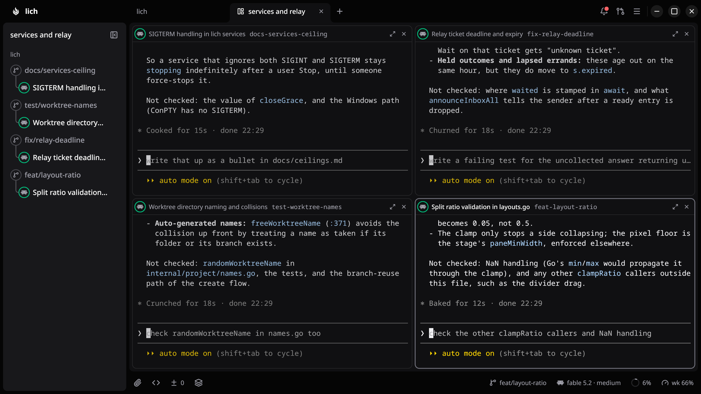
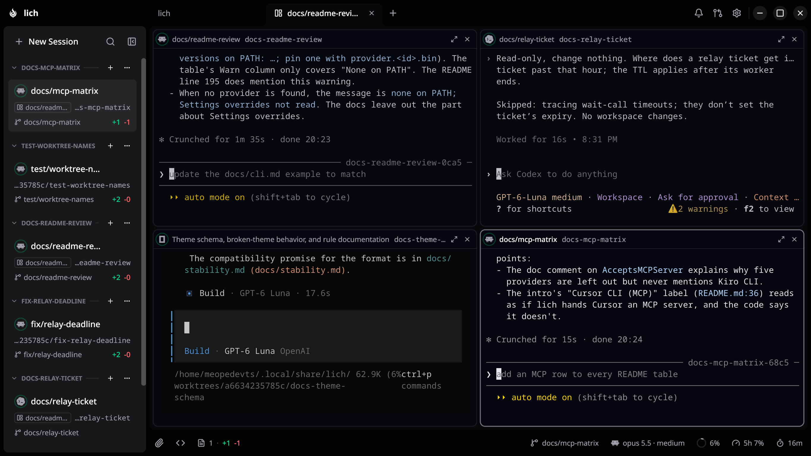
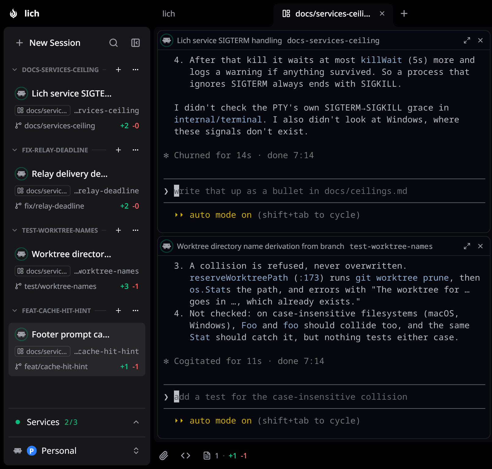
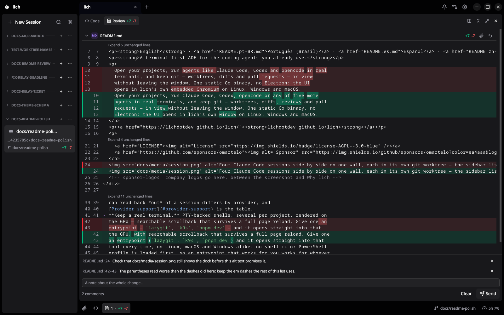
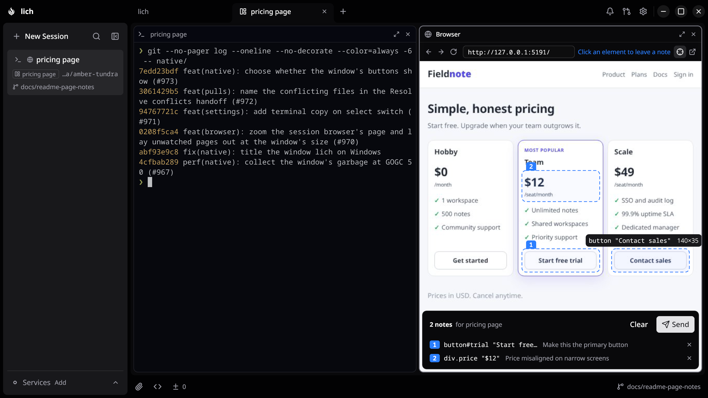
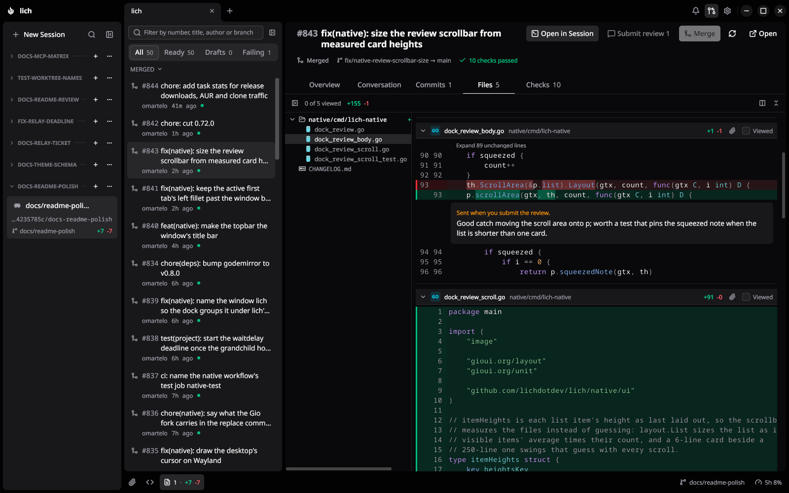
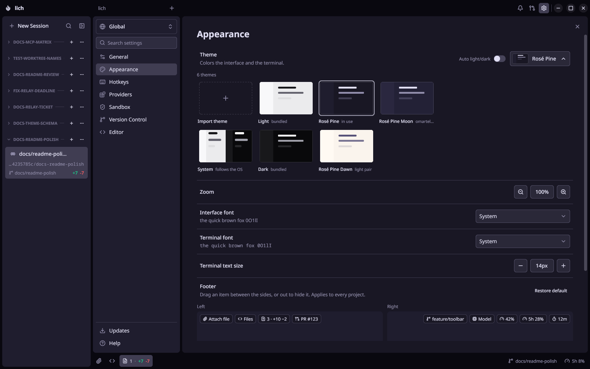

<div align="center">
  
  <h1>lich</h1>
  <p><a href="README.md">English</a> · <a href="README.pt-BR.md">Português (Brasil)</a> · <a href="README.es.md">Español</a> · <a href="README.zh-CN.md">简体中文</a> · <a href="README.ja.md">日本語</a> · <a href="README.ko.md">한국어</a> · <strong>Русский</strong></p>
  <p>
    <a href="https://github.com/lichdotdev/lich/releases"></a>
    
    <a href="LICENSE"></a>
    <a href="https://github.com/sponsors/omartelo"></a>
  </p>
  <p>
    <strong>Мультиагентная ADE: все ваши ИИ-агенты работают одновременно, каждый в своей ветке.</strong><br/>
    Claude Code, Codex, opencode или тот агент, которым вы уже пользуетесь: у каждого свой worktree, и всё в одном окне.
  </p>
  <h3><a href="#установка">Скачать lich</a> · <a href="https://lichdotdev.github.io/lich/index.ru.html">lichdotdev.github.io/lich</a></h3>
  
  <!-- sponsor-logos: company logos go here, between the screenshot and Features -->
</div>

## Возможности

<table>
<tr>
<td width="50%" valign="middle">

### Агенты бок о бок

Выведите сессии на один экран, и lich сам разложит панели. С первого взгляда видно, какая сессия занята, какая ждёт вас и сколько контекста у неё осталось.

</td>
<td width="50%"></td>
</tr>
<tr>
<td width="50%" valign="middle">

### Worktree под каждую задачу, без настройки

Создайте сессию от любой базовой ветки, и lich скопирует ваши `.env`-файлы и выделит ей свободный порт для dev-сервера. Незакоммиченные изменения можно взять с собой.

</td>
<td width="50%"></td>
</tr>
<tr>
<td width="50%" valign="middle">

### Читайте diff, комментируйте строки

Смотрите, что изменил агент, рядом с его сессией, комментируйте строки, которые нужно доработать, и отправляйте все заметки назад одним промптом.

</td>
<td width="50%"></td>
</tr>
<tr>
<td width="50%" valign="middle">

### Укажите на странице, скажите агенту

Агент управляет браузером рядом со своей сессией, а вы пользуетесь той же страницей. Укажите, что не так, оставьте на этом заметку и отправьте все заметки обратно одним промптом.

</td>
<td width="50%"></td>
</tr>
<tr>
<td width="50%" valign="middle">

### Pull request'ы без браузера

Откройте pull request, попросите агента ветки написать его, прочитайте прямо в коде и смёржите, не выходя из того же окна.

</td>
<td width="50%"></td>
</tr>
<tr>
<td width="50%" valign="middle">

### Настройте под себя

Импортируйте тему как JSON или установите её из git-репозитория.

[Документация →](docs/themes.md)

</td>
<td width="50%"></td>
</tr>
</table>

А ещё:

- **Сессии, которые делегируют.** Один агент передаёт задачу другой сессии и получает ответ обратно. То же работает из вашей оболочки через команду `lich` ([документация](docs/cli.md)).
- **Агенты в песочнице.** Позвольте агенту пропускать запросы разрешений внутри песочницы, где не видны ваши ключи, учётные данные и остальные репозитории ([ограничения](docs/ceilings.md)).
- **Ваши dev-серверы в боковой панели.** Сохраните то, что проект держит запущенным, и запускайте или останавливайте это одним щелчком.
- **Поиск по всему.** `Ctrl`/`Cmd`+`K` открывает сессию по имени или по тому, что в ней обсуждалось.
- **Знайте, когда вы нужны.** Уведомление на рабочем столе, когда сессия ждёт вас.

## Установка

```bash
curl -fsSL https://raw.githubusercontent.com/lichdotdev/lich/main/install.sh | sh
```

Одна строка: она определит ваш дистрибутив, проверит загрузку и установит lich через ваш пакетный менеджер.

| Платформа | Где взять |
| --- | --- |
| **Linux** | `install.sh` выше или AUR [`lich-bin`](https://aur.archlinux.org/packages/lich-bin) (`yay -S lich-bin`). Нужны `zenity` и glibc 2.34 или новее (Debian 12, Ubuntu 22.04, RHEL 9 и новее). |
| **macOS** | `brew install --cask lichdotdev/tap/lich` |
| **Windows** | Установщик или portable zip со страницы [Releases](https://github.com/lichdotdev/lich/releases) либо `scoop install https://github.com/lichdotdev/lich/releases/latest/download/lich.json` |

Сборки для macOS и Windows пока не подписаны, поэтому Gatekeeper и SmartScreen
предупреждают о файле, скачанном со страницы Releases; при установке через
Homebrew запроса Gatekeeper нет. Пакеты под отдельные дистрибутивы, tarball для
Linux, снятие флага карантина и переход со старой формулы Homebrew описаны в
[INSTALL.md](INSTALL.md).

## Быстрый старт

1. **Откройте проект.** Кнопка `+` на панели вкладок показывает недавно
   закрытые проекты и открывает диалог выбора папки. Выберите git-репозиторий.
2. **Выберите агента.** При первом запуске lich покажет агентов, которых нашёл на
   вашей машине. В разделе Настройки › Провайдеры задаются агент по умолчанию и
   путь к исполняемому файлу каждого.
3. **Запустите сессию.** Кнопка *Новая сессия* открывает вашего агента в проекте.
   Кнопка `+` в заголовке checkout открывает любого агента или обычный терминал
   именно в этом checkout.
4. **Создайте worktree** *(по желанию)* от любой базовой ветки: lich откроет в
   нём новую сессию.

## Поддержка провайдеров

Каждый агент работает в настоящем терминале, возобновляет свой разговор, работает
в песочнице и добирается до ваших остальных сессий. Отличается то, что lich может
прочитать из сессии, потому что каждый CLI записывает своё.

<details>
<summary>Что поддерживает каждый агент</summary>

| Что вы получаете | Claude Code | Codex | Antigravity | opencode | oh-my-pi | Crush | Cursor CLI | Kiro CLI |
| --- | :-: | :-: | :-: | :-: | :-: | :-: | :-: | :-: |
| Установка с экрана приветствия | да | да | да | да; не в Windows | да | через npm, в macOS через Homebrew | да | Linux и macOS |
| Вход с экрана приветствия | да | да | нет, при первом запуске | в терминале, с открытым проектом | в терминале, с открытым проектом | нет, при первом запуске | в терминале, с открытым проектом; не в macOS | в терминале, с открытым проектом; только Linux |
| Окно контекста в нижней панели | да | да | нет | нет | нет | нет | нет | да |
| Какая доля последнего хода пришла из кэша промптов, в нижней панели | да | да | нет | в подсказке стоимости | в подсказке стоимости | нет | нет | нет |
| Подсказка карточки называет работающую модель и ту, на которой сессия открылась, если она сменилась | да | да | нет | нет | нет | нет | нет | да |
| Стоимость в нижней панели | да | да | нет | да | да | да | нет | кредиты |
| Разговор, ответвлённый прямо в терминале агента, оплачивает скопированную историю один раз | да, кроме случая, когда стоимость измерил сам Claude Code | нет | стоимость не показывается | да | да, кроме хода, сохранённого без id ответа | не умеет ответвлять | стоимость не показывается | стоимость не показывается |
| Сколько осталось от лимитов подписки | да | да | да | только OpenCode Go | нет | нет | да | нет |
| Сколько потрачено сверх подписки и каков потолок, в подсказке об использовании | да | нет | нет | нет | нет | нет | нет | нет |
| Использовать сброс лимита, который даёт подписка, из панели профиля в боковой панели | да | нет | нет | нет | нет | нет | нет | нет |
| Сбросы лимита по запросу, которые есть у аккаунта, в подсказке об использовании | нет | да | нет | нет | нет | нет | нет | нет |
| Ход, который остановился на лимите подписки, продолжается сам, когда лимит сбросится | да | да | нет | свои повторные попытки | свои повторные попытки | нет | нет | нет |
| Если в другом вашем профиле лимит ещё не исчерпан, уведомление предложит сразу продолжить там | да | да | нет | нет | нет | нет | нет | нет |
| Передавая работу, агент может предложить один из ваших профилей для преемницы, а уведомление оставляет решение за вами | да | да | нет | нет | да | нет | Linux и Windows | только Linux |
| Индикатор, пока идёт ход, и кольцо, когда он закончился | да | да | да | да | да | с Crush 0.99.0 | да | да |
| Карточка получает название разговора | да | по первому запросу | по первому запросу | да | да, со второго хода | когда закончится первый ход, с Crush 0.99.0 | да, когда закончится первый ход | по первому запросу, когда закончится первый ход |
| Pull request, открытый агентом, появляется на его карточке по окончании хода | да | да | да | да | да | с Crush 0.99.0; в более ранних версиях только когда окно снова получит фокус | да | да |
| Задача, переданная агенту, возвращается сама, когда его ход заканчивается | да | да | да | да | да | с Crush 0.99.0; в более ранних версиях он отвечает через reply_to_session | в чате; в терминале он отвечает через reply_to_session | да |
| Задача ждёт команды и субагентов, которых агент оставил работать в фоне, а не возвращается с промежуточным ответом | в чате; в терминале со следующего релиза lich-plugin | нет | нет | нет | в терминале | нет | фоновые команды, в чате | нет |
| Перерисовывается в новом виде, когда вы переключаете lich между светлой и тёмной темой | да | нет | нет | да | да | нет | да | нет |
| Колокольчик, когда агент не может продолжить без вас | да | да | нет | да | нет | с Crush 0.99.0 | нет | нет |
| Ctrl+Shift+I переходит к следующей сессии, которая ждёт вас | да | да | нет | да | нет | с Crush 0.99.0 | нет | нет |
| Программа в терминале агента может задавать статус карточки (OSC 7501), пока агент работает | нет | нет | нет | нет | нет | до Crush 0.99.0 | нет | нет |
| После выхода из агента в оболочку без меток приглашения программа снова может задавать статус карточки | да | нет | нет | нет | нет | да | да | нет |
| В трее видно сессии, которые ждут вас, и те, что работают, а на значке появляется точка | да | да | только работающие | да | только работающие | с Crush 0.99.0 | только работающие | только работающие |
| Карточка показывает, что разговор сейчас сжимается | в чате | в чате | в чате: только введённая вами /compact | в чате: только введённая вами /compact или /summarize | в чате: только введённая вами /compact | нет | не проверено | в чате |
| Фильтр боковой панели по состоянию: Ждут, Работают, Непрочитанные | да | да | нет «Ждут» | да | нет «Ждут» | с Crush 0.99.0; в более ранних версиях всегда «Простаивают» | нет «Ждут» | нет «Ждут» |
| Если ваш агент запускает его внутри другой сессии (`claude -p`, `cursor-agent -p`), он не попадает на карточку этой сессии | да | да | да | да | да | да | да | нет |
| Помимо инструментов для связи с другими сессиями, агенту говорят, когда ими пользоваться (передавать работу сессии в своём worktree) | да | да, если в вашем `config.toml` не задан `developer_instructions` | да | да | да | да | не измерялось | да |
| Машина не уходит в сон по простою, пока идёт ход | да | да | да | да | да | с Crush 0.99.0 | да | да |
| Сессии, пересылающие сообщения без работы между ними, вдвоём или по кругу из нескольких, останавливаются | да | да | да | да | да | с Crush 0.99.0 | да | да |
| Блок **Последний ход** на вкладке «Ревью» с итогом от агента | да | да | да | да | да | нет | да | да |
| Поиск по разговору из палитры | да | да | да | да | да | да | нет | да |
| Возобновление разговора, начатого вне lich, из вкладки «История» в палитре | да | да | да | да | да | Linux; на macOS и Windows не проверялось | да | да |
| Длинная вставка может попасть в промпт редактируемым текстом, а не свёрнутой заглушкой (Настройки › Провайдеры, по умолчанию выключено) | да | нет | нет | да | не измерялось | нет, она превращается во вложение `paste_N.txt` | нет | да |
| Форк разговора в новый worktree, а также в собственном checkout сессии | да | да | нет | да | нет | нет | нет | нет |
| Форк висит под исходной сессией в дереве боковой панели | да | да | нет | да | нет | нет | нет | нет |
| Предупреждение, если вы возобновляете в приложении самого агента разговор, который открыт в другой карточке | да | при следующем промпте | при следующем промпте, не проверено | нет | да | при следующем промпте с Crush 0.99.0; в более ранних версиях при следующем вызове инструмента | нет | да |
| Агенту сообщают, когда он правит файл, который несколько минут назад правила другая сессия, и какая именно | да | да | да | да | да | с Crush 0.99 | да | с вашим следующим сообщением |
| Открытие сессии с выбранным уровнем рассуждений | да | да | да | нет | да | нет | в названии модели | да |
| Открытие сессии с включённым ultracode | да | нет | нет | нет | нет | нет | нет | нет |
| Несколько аккаунтов рядом в виде профилей, у каждого свой полноценный логин, а сессия, переведённая на другой аккаунт, продолжает работу в той же карточке (Настройки › Провайдеры) | да, у каждого профиля свои плагины, модель и уровень рассуждений по умолчанию, а остальные настройки профиля «Личный» общие для всех | да, у каждого профиля свои плагины, модель и уровень рассуждений по умолчанию, а остальные настройки профиля «Личный» общие для всех | нет | да, логин из терминальной карточки; перевести сессию в другой профиль нельзя, потому что её разговоры лежат в той же базе данных, что и логин; последняя выбранная модель становится моделью по умолчанию для всех профилей | да, логин из терминальной карточки, у каждого профиля свои модели по умолчанию, остальные настройки общие для всех профилей | не измерялось | Linux и Windows (на macOS логин хранится в связке ключей), логин из терминальной карточки, `mcp.json`, хуки и навыки общие для всех профилей | только Linux (на macOS логин хранится в связке ключей, а на Windows его ничем не перенести), логин из терминальной карточки, разговоры и модель по умолчанию общие для всех профилей |
| Папка, которую вы отметили как доверенную в основном аккаунте, открывается без вопроса «trust this folder?» во всех остальных профилях | да | да | нет профилей | ничего не спрашивает | ничего не спрашивает | не измерялось | да | ничего не спрашивает |
| Сессия в песочнице открывается без вопроса «trust this folder?» | да | да | да | ничего не спрашивает | ничего не спрашивает | да, и больше не спрашивает, инициализировать ли проект | да | ничего не спрашивает |
| Worktree доверенной папки открывается без вопроса «trust this folder?» | да | да | да | ничего не спрашивает | ничего не спрашивает | да, и больше не спрашивает, инициализировать ли проект | да | ничего не спрашивает |
| Управление сессией в виде чата из `lich control` или агентом: промпт, остановка, модель, уровень рассуждений, слэш-команда; сессия в терминале отклоняется | да | да; модель или уровень рассуждений действуют со следующего сообщения | да | да | да | чата нет | не проверено | да, без уровня рассуждений, а модель только между ходами |
| Субагент, запущенный агентом, работает как сессия lich со своей карточкой в checkout сессии, которая его запросила, возвращает ей полный отчёт и закрывается, когда закончит; его собственные субагенты тоже получают карточки, уровнем ниже | да | да | да | да | да | да | в терминале; его чат не запускает хуки | да |
| Контекст, стоимость и расход лимитов подписки в том виде, в каком их измерил сам CLI | в чате | нет | нет | нет | нет | нет | нет | нет |
| Приватное делегирование из субагента или шага workflow | да | да | да | да | да | да | да | да |
| Возобновлённая сессия сохраняет модель и уровень рассуждений, с которыми работала | только модель | да | нет | модель | да | нет | модель | модель; уровень рассуждений не проверялся |
| Результат продолжает ждать вас, даже если вы прервали его ожидание | да | да | да | да | нет | да | да | да |
| Задача, переданная другой сессии, сразу возвращается как «без ответа», если тот агент завершил ход и не ответил | да | да | да | да | да | нет, ждёт истечения срока | да | да |
| Сообщения самого lich агенту (переданные задачи, готовые результаты, уведомления) на выбранном вами языке промптов | да | да | да | да | да | да | да | да |
| При запуске агент получает указание на языке промптов раздавать работу сессиям lich, а не скрытым субагентам | да | нет | нет | нет | да | нет | нет | нет |
| Карточка сессии открывает браузер, которым управляет агент, рядом с терминалом сессии | да | да | да | да | да | да | да | да |
| Страница, которую агент делает, чтобы показать вам (отчёт, диаграмма, макет), открывается в этом браузере из собственной папки сессии вне чекаута и хранится, пока существует сессия | да, но Claude Code может опубликовать её на claude.ai своим инструментом Artifact | да | да | да | да | да | да | да |
| Навык для написания расширения lich, который запускается только по вашему вызову (`/lich:extension`) | да | да, как `$lich:extension` | да, но агент видит его каждый ход: Antigravity не умеет оставлять навык только для ручного вызова | да, как `/lich-extension` (opencode 1) или из `/skills` (opencode 2) | да, как `/skill:lich-extension` | да, из палитры команд | да, но агент видит его каждый ход: Cursor показывает агенту все навыки плагина | нет: Kiro не умеет убирать навык из контекста агента |
| Сессию можно показывать как чат вместо терминала и переключаться между ними в том же разговоре | да | да | да | да | да | нет | не проверено | да |
| Новая сессия открывается как чат, а в терминале, если так выбрано в Настройки › Провайдеры | да | да | да | да | да | нет, всегда в терминале | не проверено | да |
| Сессия в виде чата получает задачи и уведомления, которые ей шлют другие сессии | да | да; ответ инструментами lich из чата не проверен | да; ответ инструментами lich из чата не проверен | да; ответ инструментами lich из чата не проверен | да; ответ инструментами lich из чата не проверен | чата нет | не проверено | да; ответ инструментами lich из чата не проверен |
| Выбор в чате модели, уровня рассуждений и режима, которые предлагает агент | да, включая режим, в котором любой инструмент запускается без вопросов | да, включая режим, в котором все инструменты запускаются без вопросов; изменение действует со следующего сообщения | да | да | да | нет | не проверено | модель и режим, без уровня рассуждений |
| В чате вопросы агента приходят карточкой, на которую отвечаешь кликом или клавишей | да | не проверено | да | да в opencode 1; opencode 2 не проверено | да | нет | не проверено | нет: Kiro спрашивает обычным текстом |
| В чате план, к которому агент просит приступить, приходит карточкой с планом: начать, принимая все правки автоматически или одобряя каждую, или продолжить планирование, написав, что изменить | да; вариантов терминала с очисткой контекста, обходом разрешений, авторежимом и Ultraplan нет | нет: в чате нет режима плана | не проверено | не проверено; opencode спрашивает своим вопросом, который приходит карточкой вопроса | не проверено | нет чата | не проверено | не проверено |
| В чате / в начале строки открывает список команд и скиллов агента для подстановки | да, скиллы отмечены | только скиллы, в виде `$имя` | да | да | да | нет | не проверено | да |
| В чате @ в начале слова открывает список файлов и папок проекта, чтобы вставить путь в сообщение | да; Claude Code сам читает файл | да; путь уходит текстом, и агент открывает его своими инструментами | да; путь уходит текстом, что агент с ним делает, не проверено | да; путь уходит текстом, что агент с ним делает, не проверено | да; путь уходит текстом, что агент с ним делает, не проверено | нет | не проверено | да; путь уходит текстом, что агент с ним делает, не проверено |
| В чате строка, которая начинается с !, выполняется в проекте как команда оболочки, без агента и без запроса разрешения | да; агент получает вывод и отвечает на него, как с ! в самом Claude Code | да; агент видит её с вашим следующим сообщением, а после перезапуска чата её нет | нет: строка уходит агенту как есть | да в opencode 1, и агент её видит; opencode 2 отправляет строку как есть | нет: строка уходит агенту как есть | нет | нет: строка уходит агенту как есть | нет: строка уходит агенту как есть |
| В чате сжатие видно, пока оно идёт, а после него остаётся строка с числом токенов до и после | да | да | только введённая вами /compact | только введённая вами /compact или /summarize | только введённая вами /compact | нет | не проверено | да, без числа токенов |
| В чате Shift+Tab переключает на следующий режим, который предлагает агент, но никогда на режим, где все инструменты работают без вопросов | да, в порядке самого Claude Code | да | да | да | да | нет | не проверено | да |
| В чате /mcp показывает MCP-серверы агента и их инструменты: сервер можно выключить или включить, переподключить или войти в него, а /skills показывает скиллы, которые можно включать и выключать | да; выключенный скилл записывается в `.claude/settings.local.json` в рабочей копии | да; в профиле, который не относится к основной учётной записи, изменение отменяется при следующем запуске сессии в нём | нет | нет | нет | нет | нет | нет |
| В чате /plugin показывает плагины агента: их можно установить, обновить, выключить или удалить, а маркетплейсы добавить, обновить или убрать | да; обновление начинает работать после перезапуска чата | да; устанавливает только для вас, из маркетплейсов на вашей машине, и не обновляет плагины | нет | нет | нет | нет | нет | нет |
| В чате /permissions показывает правила агента «разрешить», «спрашивать» и «запретить» и папки, где он может работать: правило можно добавить в файл настроек или удалить | да; папки только показываются, добавить или убрать их нельзя | показывает режимы, чтобы выбрать один: правил у Codex нет | нет | нет | нет | нет | нет | нет |
| В чате /hooks показывает хуки агента по событиям | да; только для чтения, как в его собственном /hooks | да; хуку можно доверять, выключить его или включить | нет | нет | нет | нет | нет | нет |
| В чате /memory показывает файлы инструкций, которые загружает агент, и сохранённые им заметки: их можно открыть и изменить, а автопамять включить или выключить; /agents показывает субагентов: можно открыть файл любого или добавить нового | да | да; /memory показывает AGENTS.md, загруженные в разговоре, а /agents роли из вашего `config.toml`, без встроенных и без возможности добавить новую | нет | нет | нет | нет | нет | нет |
| В чате вызов инструмента появляется сразу, как начался, со счётчиком времени, и потом показывает, сколько он шёл | да | да; в перечитанном разговоре времени нет | не проверено | не проверено | не проверено | нет | не проверено | не проверено |
| В чате сообщение, написанное, пока агент работает, ждёт в очереди и уходит, когда ход закончится, или отправляется сразу в идущий ход | да | да | в очередь; отправка сразу останавливает ход и шлёт сообщение после | в очередь; отправка сразу останавливает ход и шлёт сообщение после | в очередь; отправка сразу останавливает ход и шлёт сообщение после | нет | не проверено | в очередь; отправка сразу останавливает ход и шлёт сообщение после |
| В чате список задач агента стоит над полем сообщения, пока в нём есть невыполненные задачи | да; ваш собственный `CLAUDE_CODE_ENABLE_TODO_TOOLS` сохраняется, а со значением 0 список на моделях Claude 5 не появляется | да; в возобновлённом разговоре список появляется, когда агент его обновит | не проверено | не проверено | да | нет чата | не проверено | не проверено |
| В чате значок в поле сообщения считает команды, которые агент оставил работать в фоне, и открывает их, чтобы прочитать вывод и остановить любую | да; они останавливаются вместе с процессом чата, при переходе в TUI, по /new или при переходе в режим YOLO | нет | нет | нет | нет | нет чата | нет | нет |
| В чате Ctrl+B переводит в фон команду, которую ждёт агент: она продолжает работать, а агент идёт дальше | да; строка, где видно, что агент работает, подсказывает, когда это можно | нет | нет | нет | нет | нет чата | нет | нет |
| В чате приложенное изображение доходит до агента как изображение, а любой другой файл как путь к нему в сообщении | да | уходит как изображение; видит ли его агент, не проверено | уходит как изображение; видит ли его агент, не проверено | уходит как изображение; видит ли его агент, не проверено | уходит как изображение; видит ли его агент, не проверено | нет | не проверено | уходит как изображение; видит ли его агент, не проверено |
| В чате, когда заканчивается начатый вами ход, пустое поле сообщения подсказывает, что вы, скорее всего, напишете дальше, и Tab вставляет подсказку в поле | да | да; lich спрашивает ту же модель с низким усилием, что расходует немного вашего плана | нет | нет | нет | нет чата | нет | нет |

</details>

Все пробелы намеренные: что именно измерялось за каждым из них, описано в
[`docs/ceilings.md`](docs/ceilings.md).

## Настройка

- **Провайдеры.** В разделе Настройки › Провайдеры задаются путь к исполняемому
  файлу каждого агента и агент по умолчанию для всех проектов; проект может
  выбрать свой. Если путь не задан, lich запускает первый исполняемый файл из
  `PATH` вашей login-оболочки, а `lich doctor` предупреждает, если версий
  несколько.
- **Нижняя панель.** В разделе Настройки › Оформление перетаскиванием элементов
  выбирается, что она показывает. Стоимость по умолчанию скрыта, потому что эта
  цифра имеет смысл, только если вы платите за токены.
- **Worktree.** Файл `.worktreeinclude` в проекте задаёт, какие файлы,
  игнорируемые git, попадут в новый worktree.
- **Хуки сессии.** Установите [плагин lich](https://github.com/lichdotdev/lich-plugin)
  из настроек, и сессия сама даст название своей карточке и обновит статус git
  сразу, как только запишет файл.
- **Скрипты.** В [docs/stability.md](docs/stability.md) сказано, какие части lich
  можно спокойно использовать в скриптах.

## Конфиденциальность и обновления

Всё работает на вашей машине: ни аккаунта, ни входа, ни телеметрии. lich выходит
в сеть только за следующим:

- **Обновления**: проверка версии в GitHub Releases при запуске и раз в час, а
  также список релизов плагина lich при запуске.
- **Лимиты подписки**: собственный эндпоинт каждого провайдера с данными об
  использовании (Anthropic, OpenAI, Cursor, OpenCode Go), с тем логином, который
  уже использует агент, не чаще раза в пять минут. Подписку Antigravity lich
  узнаёт у самого `agy`.
- **Цены**: публичная таблица цен LiteLLM на GitHub, один раз для модели,
  которой нет во встроенной таблице.

Версия из установщика для Windows обновляется на месте; установки через
Homebrew, Scoop, AUR или пакет Linux обновляются своим пакетным менеджером, и
lich подскажет нужную команду.
Что-то сломалось? `lich doctor` проверит вашу настройку, а `lich rage` соберёт
отчёт об ошибке в один архив и ничего никуда не загрузит. Раздел Настройки ›
Справка ещё до того, как вы приложите файл журнала, показывает, что в нём есть:
пути, названия проектов и веток, ваш логин gh, но никогда не токен сессии. Об
ошибках и с пожеланиями пишите в
[Issues](https://github.com/lichdotdev/lich/issues), а что изменилось в каждой
версии, смотрите в [CHANGELOG.md](CHANGELOG.md).

## Сборка из исходников

lich состоит из двух бинарников: `lich`, статический бэкенд на чистом Go, и
`lich-native`, окно, которое собирается с cgo из `native/`. Понадобятся
**Go 1.27.0+** и **[Task](https://taskfile.dev)**; для окна нужны ещё компилятор
C, системные пакеты Gio, `libturbojpeg` из libjpeg-turbo и `libghostty-vt`,
собранная из коммита, указанного в
`native/GHOSTTY_COMMIT`. Как её собрать, описано в
[`native/slice.sh`](native/slice.sh), а само окно в
[`docs/native-window.md`](docs/native-window.md).

```bash
task build          # бинарник бэкенда -> bin/lich
task build:native   # окно -> bin/lich-native
task run            # сборка + запуск
task test           # тесты Go
task package        # .deb + .rpm + Arch .pkg.tar.zst in bin/ (нужен nfpm)
```

Добавление ещё одного агента затрагивает дюжину файлов в двух репозиториях:
карта всех мест: [`docs/adding-a-provider.md`](docs/adding-a-provider.md).

## Спонсоры

lich пишет и поддерживает один человек. Спонсорство оплачивает время, которое
уходит на проект, и сохраняет его независимость: платной версии приложения нет
и не будет.

[**Стать спонсором**](https://github.com/sponsors/omartelo)

<!-- sponsor-names: monthly sponsors go here -->

### Поддержавшие

<!-- backers: one-time supporters go here -->

Пока никого.

## Лицензия

[AGPL-3.0-only](LICENSE) © 2026 omartelo

lich — свободное программное обеспечение: вы можете использовать, изучать,
изменять и распространять его на условиях GNU Affero General Public License v3.
Любая производная работа, которую распространяют или предоставляют по сети,
должна выходить под той же лицензией. Релизы до v0.9.0 включительно остаются
под лицензией MIT.
