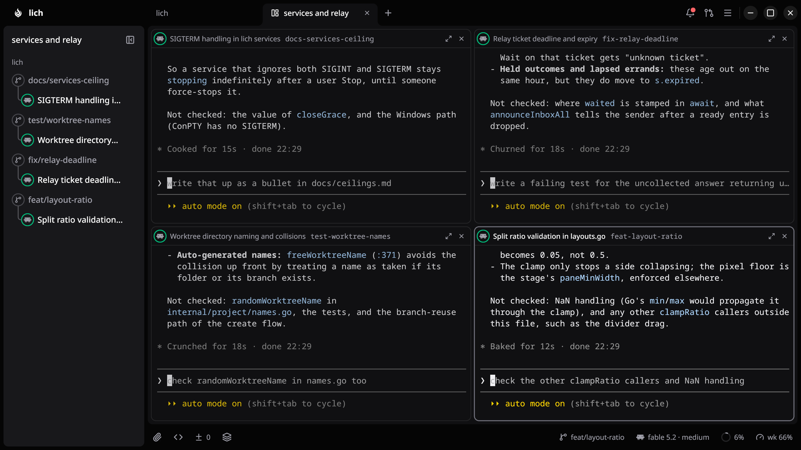
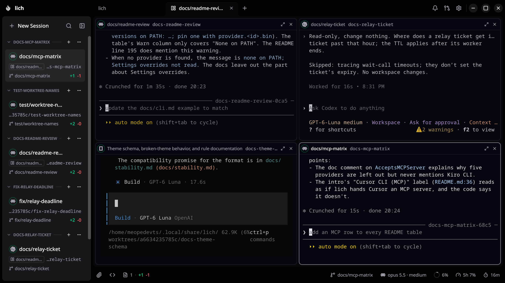
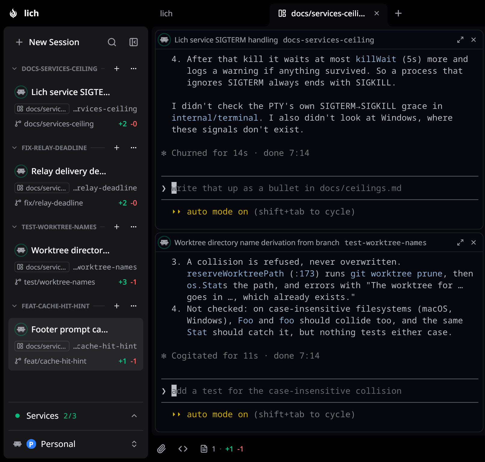
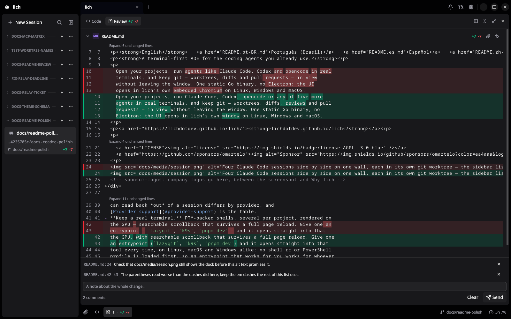
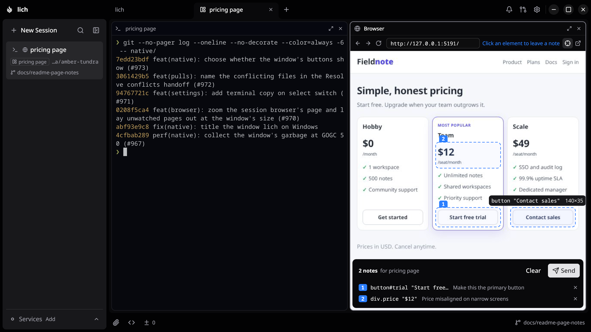
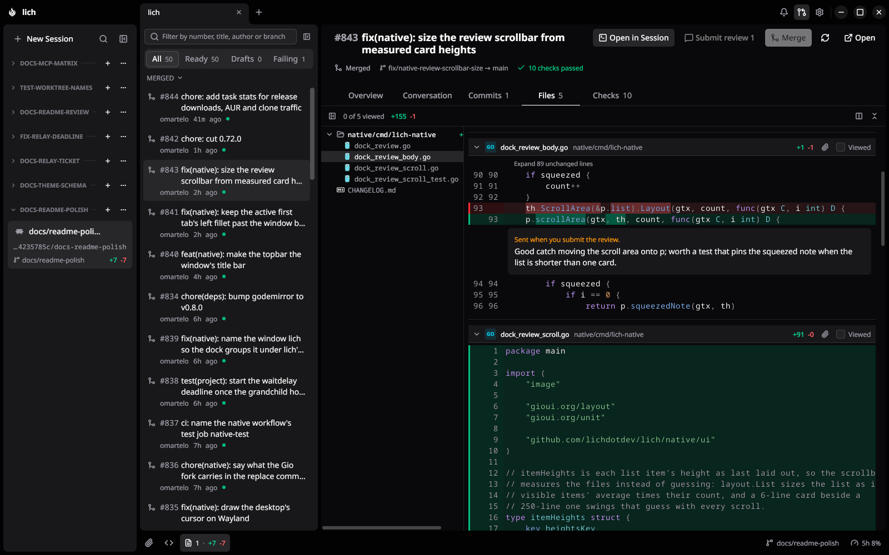
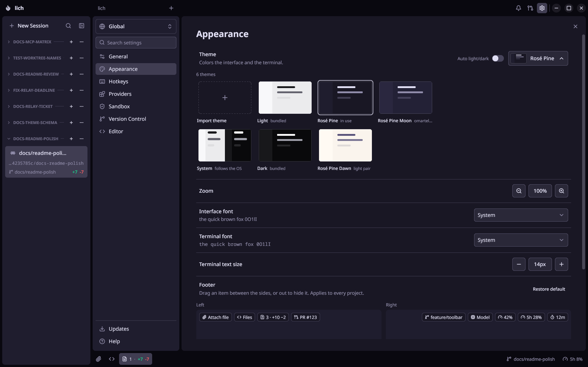

<div align="center">
  
  <h1>lich</h1>
  <p><a href="README.md">English</a> · <a href="README.pt-BR.md">Português (Brasil)</a> · <a href="README.es.md">Español</a> · <strong>简体中文</strong> · <a href="README.ja.md">日本語</a> · <a href="README.ko.md">한국어</a> · <a href="README.ru.md">Русский</a></p>
  <p>
    <a href="https://github.com/lichdotdev/lich/releases"></a>
    
    <a href="LICENSE"></a>
    <a href="https://github.com/sponsors/omartelo"></a>
  </p>
  <p>
    <strong>多智能体 ADE：让所有编程智能体同时开工，各自在自己的分支上。</strong><br/>
    Claude Code、Codex、opencode，或者你已经在用的智能体，各自在独立的 worktree 里，全都在同一个窗口中。
  </p>
  <h3><a href="#安装">下载 lich</a> · <a href="https://lichdotdev.github.io/lich/index.zh-CN.html">lichdotdev.github.io/lich</a></h3>
  
  <!-- sponsor-logos: company logos go here, between the screenshot and Features -->
</div>

## 功能

<table>
<tr>
<td width="50%" valign="middle">

### 智能体并排运行

把会话放到同一个分屏里，lich 替你排好各个面板。哪个在忙、哪个在等你、还剩多少上下文，一眼就能看出来。

</td>
<td width="50%"></td>
</tr>
<tr>
<td width="50%" valign="middle">

### 每个任务一个 worktree，无需准备

从任意基础分支开出一个会话，lich 会复制你的 `.env` 文件，并分配一个空闲的开发服务器端口。尚未提交的改动也可以一起带过去。

</td>
<td width="50%"></td>
</tr>
<tr>
<td width="50%" valign="middle">

### 审查 diff，逐行评论

在会话旁边看智能体改了什么，给需要返工的行写评论，再把所有评论合成一条 prompt 发回去。

</td>
<td width="50%"></td>
</tr>
<tr>
<td width="50%" valign="middle">

### 指着页面，告诉代理

代理在会话旁边操作浏览器，你也在用同一个页面。指出哪里不对，在上面留下备注，再把所有备注作为一条提示发回去。

</td>
<td width="50%"></td>
</tr>
<tr>
<td width="50%" valign="middle">

### 不开浏览器也能处理 Pull Request

创建 Pull Request，请该分支的智能体来写，直接在 diff 里审查，再合并，全程不离开这个窗口。

</td>
<td width="50%"></td>
</tr>
<tr>
<td width="50%" valign="middle">

### 做成你喜欢的样子

可以导入 JSON 主题，也可以从 git 仓库安装。

[文档 →](docs/themes.md)

</td>
<td width="50%"></td>
</tr>
</table>

此外还有：

- **会话之间互派任务。** 一个智能体把任务交给另一个会话，再拿回答案。在 shell 里用 `lich` 命令也能做到同样的事（[文档](docs/cli.md)）。
- **沙箱里的智能体。** 让智能体在沙箱里跳过权限确认，沙箱看不到你的密钥、凭据和其他仓库（[限制](docs/ceilings.md)）。
- **开发服务器就在侧栏。** 保存项目需要一直开着的东西，一键启动或停止。
- **什么都找得到。** `Ctrl`/`Cmd`+`K` 可以按名称或聊过的内容跳到会话。
- **需要你时会知会你。** 会话在等你回复时，弹出桌面通知。

## 安装

```bash
curl -fsSL https://raw.githubusercontent.com/lichdotdev/lich/main/install.sh | sh
```

一行命令即可：脚本会识别你的发行版、校验下载内容，再通过包管理器安装 lich。

| 平台 | 获取方式 |
| --- | --- |
| **Linux** | 上面的 `install.sh`，或 AUR 的 [`lich-bin`](https://aur.archlinux.org/packages/lich-bin)（`yay -S lich-bin`）。需要 `zenity` 和 glibc 2.34 或更高版本（Debian 12、Ubuntu 22.04、RHEL 9 及以上）。 |
| **macOS** | `brew install --cask lichdotdev/tap/lich` |
| **Windows** | 从 [Releases](https://github.com/lichdotdev/lich/releases) 下载安装程序或便携版 zip，或用 `scoop install https://github.com/lichdotdev/lich/releases/latest/download/lich.json` |

macOS 和 Windows 的构建还没有签名，所以从 Releases 下载时 Gatekeeper 和 SmartScreen
会弹出警告；用 Homebrew 安装则不会触发 Gatekeeper 提示。各发行版的软件包、Linux
tarball、清除隔离标记，以及从旧的 Homebrew formula 升级，见 [INSTALL.md](INSTALL.md)。

## 快速上手

1. **打开项目。** 标签栏里的 `+` 会列出最近关闭的项目，并打开文件夹选择器。选一个 git
   仓库即可。
2. **选择智能体。** 首次启动会列出在你机器上找到的智能体。设置 › 提供商里可以设置默认智能体，
   以及每个可执行文件的路径。
3. **开启会话。** *新建会话*会在项目里打开你的智能体。每个检出目录标题栏上的 `+`，
   可以在该检出目录里打开任意智能体或普通终端。
4. **给它一个 worktree** *（可选）*。从任意基础分支创建，lich 会在其中打开一个新会话。

## 各智能体支持情况

每个智能体都在真实终端里运行，都能恢复对话，都能在沙箱里工作，也都能访问你的其他会话。
区别在于 lich 能从会话里*读出*什么，因为每个 CLI 记录的内容都不一样。

<details>
<summary>查看各智能体支持什么</summary>

| 功能 | Claude Code | Codex | Antigravity | opencode | oh-my-pi | Crush | Cursor CLI | Kiro CLI |
| --- | :-: | :-: | :-: | :-: | :-: | :-: | :-: | :-: |
| 在欢迎页安装 | 是 | 是 | 是 | 是；Windows 不支持 | 是 | 需要 npm，macOS 用 Homebrew | 是 | Linux 和 macOS |
| 在欢迎页登录 | 是 | 是 | 否，首次运行时登录 | 在终端中，需打开一个项目 | 在终端中，需打开一个项目 | 否，首次运行时配置 | 在终端中，需打开一个项目；macOS 不支持 | 在终端中，需打开一个项目；仅 Linux |
| 底栏显示上下文窗口 | 有 | 有 | 无 | 无 | 无 | 无 | 无 | 有 |
| 在底栏显示上一轮有多少来自提示缓存 | 有 | 有 | 无 | 在费用提示框中 | 在费用提示框中 | 无 | 无 | 无 |
| 在上下文提示框中显示会话在所有调用中从提示缓存重新读取的词元数 | 有 | 无 | 无 | 无 | 无 | 无 | 无 | 无 |
| 卡片提示显示正在运行的模型，若与打开时不同也显示打开时的模型 | 有 | 有 | 无 | 无 | 无 | 无 | 无 | 有 |
| 底栏显示花费 | 有 | 有 | 无 | 有 | 有 | 有 | 无 | 按点数计 |
| 在智能体自己的终端里分叉出的对话，复制来的历史只计一次花费 | 有，但花费由 Claude Code 自己统计时除外 | 无 | 不显示花费 | 有 | 有，但没有响应 ID 的轮次除外 | 无法分叉 | 不显示花费 | 不显示花费 |
| 套餐剩余额度 | 有 | 有 | 有 | 仅 OpenCode Go | 无 | 无 | 有 | 无 |
| 超出套餐的花费及其上限，显示在用量提示中 | 有 | 无 | 无 | 无 | 无 | 无 | 无 | 无 |
| 在侧边栏的配置文件面板中使用套餐赠送的限额重置 | 有 | 无 | 无 | 无 | 无 | 无 | 无 | 无 |
| 账户持有的按需重置次数，显示在用量提示中 | 无 | 有 | 无 | 无 | 无 | 无 | 无 | 无 |
| 因套餐用量上限中断的一轮，在额度重置后自动继续 | 有 | 有 | 无 | 由其自身重试 | 由其自身重试 | 无 | 无 | 无 |
| 另一个配置档案仍有额度时，通知询问是否立即在那里继续 | 有 | 有 | 无 | 无 | 无 | 无 | 无 | 无 |
| 交接时代理可以为继任会话建议你的某个配置档案，是否移动由你在通知中决定 | 有 | 有 | 无 | 无 | 有 | 无 | Linux 和 Windows | 仅 Linux |
| 一轮运行中显示转圈，结束时显示圆环 | 有 | 有 | 有 | 有 | 有 | Crush 0.99.0 起有 | 有 | 有 |
| 卡片以对话命名 | 有 | 取自你的第一条提示 | 取自你的第一条提示 | 有 | 有，从第二轮起 | 第一轮结束时，Crush 0.99.0 起 | 有，第一轮结束时 | 取自你的第一条提示，第一轮结束时 |
| 智能体开的 PR 在一轮结束时显示在卡片上 | 有 | 有 | 有 | 有 | 有 | Crush 0.99.0 起有；更早版本等窗口重新获得焦点时显示 | 有 | 有 |
| 交给智能体的任务在其一轮结束时自动返回结果 | 有 | 有 | 有 | 有 | 有 | Crush 0.99.0 起有；更早版本用 reply_to_session 回答 | 聊天中有；终端中它用 reply_to_session 回答 | 有 |
| 任务会等智能体留在后台运行的命令和子智能体结束，而不是带着中途的回复返回 | 聊天中有；终端中自 lich-plugin 下一个版本起 | 无 | 无 | 无 | 终端中有 | 无 | 仅聊天中的后台命令 | 无 |
| lich 在浅色和深色主题间切换时，按新主题重绘 | 有 | 无 | 无 | 有 | 有 | 无 | 有 | 无 |
| 智能体等你处理时响铃 | 有 | 有 | 无 | 有 | 无 | Crush 0.99.0 起有 | 无 | 无 |
| Ctrl+Shift+I 跳到下一个等你处理的会话 | 有 | 有 | 无 | 有 | 无 | Crush 0.99.0 起有 | 无 | 无 |
| 智能体运行时，其终端内的程序可以设置卡片状态（OSC 7501） | 无 | 无 | 无 | 无 | 无 | 仅 Crush 0.99.0 之前 | 无 | 无 |
| 退出智能体、回到没有提示符标记的 shell 后，程序可以再次设置卡片状态 | 有 | 无 | 无 | 无 | 无 | 有 | 有 | 无 |
| 托盘列出等你处理和正在工作的会话，图标上会出现圆点 | 有 | 有 | 仅工作中 | 有 | 仅工作中 | Crush 0.99.0 起有 | 仅工作中 | 仅工作中 |
| 对话正在压缩时，卡片上会显示 | 在聊天中 | 在聊天中 | 在聊天中：仅限你输入的 /compact | 在聊天中：仅限你输入的 /compact 或 /summarize | 在聊天中：仅限你输入的 /compact | 无 | 未验证 | 在聊天中 |
| 侧栏按状态筛选：等待中、运行中、未读 | 有 | 有 | 无“等待中” | 有 | 无“等待中” | Crush 0.99.0 起有；更早版本始终为“空闲” | 无“等待中” | 无“等待中” |
| 由你的智能体在另一个会话里调用（`claude -p`、`cursor-agent -p`）时，不会算到那个会话的卡片上 | 有 | 有 | 有 | 有 | 有 | 有 | 有 | 无 |
| 除了联系其他会话的工具，智能体还会被告知何时使用（把工作交给独立 worktree 里的会话） | 有 | 有，除非你的 `config.toml` 设置了 `developer_instructions` | 有 | 有 | 有 | 有 | 未测量 | 有 |
| 一轮运行时阻止机器空闲休眠 | 有 | 有 | 有 | 有 | 有 | Crush 0.99.0 起有 | 有 | 有 |
| 会话之间来回发消息而中间不做任何工作时会被阻止，无论是两个会话之间还是多个会话绕成的循环 | 有 | 有 | 有 | 有 | 有 | Crush 0.99.0 起有 | 有 | 有 |
| “审查”标签页的 **上一轮**，附智能体自己的总结 | 有 | 有 | 有 | 有 | 有 | 无 | 有 | 有 |
| 在命令面板里搜索对话内容 | 有 | 有 | 有 | 有 | 有 | 有 | 无 | 有 |
| 在命令面板的“历史”标签页恢复在 lich 之外开始的对话 | 有 | 有 | 有 | 有 | 有 | Linux；macOS 和 Windows 未测试 | 有 | 有 |
| 长文本粘贴可以作为可编辑的文本出现，不折叠成占位符（设置 › 提供商，默认关闭） | 有 | 无 | 无 | 有 | 未测量 | 无，会变成 `paste_N.txt` 附件 | 无 | 有 |
| 把对话分叉到新的 worktree，也可以分叉到原检出目录 | 有 | 有 | 无 | 有 | 无 | 无 | 无 | 无 |
| 分叉出的会话在侧边栏的树中挂在源会话下 | 有 | 有 | 无 | 有 | 无 | 无 | 无 | 无 |
| 在智能体自己的应用里恢复另一张卡片已打开的对话时会发出警告 | 有 | 在你下一次发提示词时 | 在你下一次发提示词时，未测试 | 无 | 有 | Crush 0.99.0 起在你下一次发提示词时；更早版本在它下一次调用工具时 | 无 | 有 |
| 编辑了另一个会话几分钟前编辑过的文件时会被告知，并说明是哪个会话 | 有 | 有 | 有 | 有 | 有 | Crush 0.99 起 | 有 | 随你的下一条消息 |
| 以指定的推理强度打开会话 | 有 | 有 | 有 | 无 | 有 | 无 | 写在模型名里 | 有 |
| 以 ultracode 模式打开会话 | 有 | 无 | 无 | 无 | 无 | 无 | 无 | 无 |
| 多个账号以配置档案并存，各自独立完整登录；会话换到另一个账号后仍在同一张卡片里继续（设置 › 提供商） | 有，每个配置档案有自己的插件、默认模型和推理强度，“个人”的其他设置由所有配置档案共用 | 有，每个配置档案有自己的插件、默认模型和推理强度，“个人”的其他设置由所有配置档案共用 | 无 | 有，在终端卡片里登录；会话不能换到另一个配置档案，因为对话和登录信息存在同一个数据库里；最后选的模型是所有配置档案的默认模型 | 有，在终端卡片里登录，每个配置档案有自己的默认模型，其他设置由所有配置档案共用 | 未测量 | Linux 和 Windows（macOS 上登录信息在钥匙串里），在终端卡片里登录，`mcp.json`、hooks 和 skills 由所有配置档案共用 | 仅 Linux（macOS 把登录信息放在钥匙串里，Windows 上没有办法迁移），在终端卡片里登录，对话和默认模型由所有配置档案共用 |
| 主账号里信任过的文件夹，在其他配置档案里打开时都不再问“trust this folder?” | 有 | 有 | 无配置档案 | 本来就不问 | 本来就不问 | 未测量 | 有 | 本来就不问 |
| 沙箱会话打开时不问“trust this folder?” | 有 | 有 | 有 | 本来就不问 | 本来就不问 | 有，也不再问是否初始化项目 | 有 | 本来就不问 |
| 信任过的文件夹，其 worktree 打开时不问“trust this folder?” | 有 | 有 | 有 | 本来就不问 | 本来就不问 | 有，也不再问是否初始化项目 | 有 | 本来就不问 |
| 用 `lich control` 或智能体操控显示为聊天的会话：发提示词、停止、换模型、换推理强度、斜杠命令；显示为终端的会话会被拒绝 | 有 | 有；模型或推理强度从你的下一条消息起生效 | 有 | 有 | 有 | 无聊天 | 未验证 | 有，没有推理强度，模型只能在两轮之间更换 |
| 智能体启动的子智能体作为 lich 会话运行：有自己的卡片，在发起会话的检出目录里工作，交回完整报告后自动关闭；子智能体再启动的子智能体也有卡片，多一层为止 | 有 | 有 | 有 | 有 | 有 | 有 | 仅终端，其聊天不运行钩子 | 有 |
| 上下文、花费和套餐用量直接采用 CLI 自己的统计 | 仅聊天中 | 无 | 无 | 无 | 无 | 无 | 无 | 无 |
| 从子智能体或工作流步骤私下委派任务 | 有 | 有 | 有 | 有 | 有 | 有 | 有 | 有 |
| 恢复的会话保留原来的模型和推理强度 | 仅模型 | 有 | 无 | 模型 | 有 | 无 | 模型 | 模型；推理强度未测试 |
| 中断等待后，结果仍会留着等你收取 | 有 | 有 | 有 | 有 | 无 | 有 | 有 | 有 |
| 交给另一个会话的任务，对方一轮结束却没回复时，立即报告“未回复” | 有 | 有 | 有 | 有 | 有 | 无，要等到截止时间 | 有 | 有 |
| lich 发给智能体的消息（派出的任务、结果已就绪、通知）使用你选的提示词语言 | 有 | 有 | 有 | 有 | 有 | 有 | 有 | 有 |
| 启动时用提示词语言告诉智能体，要把工作分派成 lich 会话，而不是看不见的子智能体 | 有 | 无 | 无 | 无 | 有 | 无 | 无 | 无 |
| 会话卡片在会话的终端旁打开一个由智能体操作的浏览器 | 有 | 有 | 有 | 有 | 有 | 有 | 有 | 有 |
| 智能体为给你看而做的页面（报告、图表、样稿）从会话自己的、位于检出之外的文件夹在那个浏览器中打开，并随会话一直保留 | 有，但 Claude Code 仍可能用它自己的 Artifact 工具发布到 claude.ai | 有 | 有 | 有 | 有 | 有 | 有 | 有 |
| 编写 lich 扩展的技能，只在你调用时运行（`/lich:extension`） | 有 | 有，用 `$lich:extension` | 有，但 Antigravity 无法把技能设为仅手动调用，智能体每一轮都能看到 | 有，opencode 1 用 `/lich-extension`，opencode 2 从 `/skills` 调用 | 有，用 `/skill:lich-extension` | 有，从命令面板 | 有，但 Cursor 会把插件的所有技能都给智能体看，智能体每一轮都能看到 | 无：Kiro 无法把技能移出智能体的上下文 |
| 会话可以显示为聊天而不是终端，并在同一对话中来回切换 | 有 | 有 | 有 | 有 | 有 | 无 | 未验证 | 有 |
| 新会话以聊天打开；在设置 › 提供商中选择终端时则在终端中打开 | 有 | 有 | 有 | 有 | 有 | 无，始终在终端中 | 未验证 | 有 |
| 显示为聊天的会话能收到其他会话发来的任务和通知 | 有 | 有；在聊天中用 lich 的工具回复未验证 | 有；在聊天中用 lich 的工具回复未验证 | 有；在聊天中用 lich 的工具回复未验证 | 有；在聊天中用 lich 的工具回复未验证 | 无聊天 | 未验证 | 有；在聊天中用 lich 的工具回复未验证 |
| 在聊天中选择智能体提供的模型、推理强度和模式 | 有，包括一个不经询问就运行任何工具的模式 | 有，包括无需询问即可运行所有工具的模式；更改从你的下一条消息起生效 | 有 | 有 | 有 | 无 | 未验证 | 仅模型和模式，没有推理强度 |
| 在 Settings › Providers 中，按配置文件和项目，从智能体上一次聊天提供的选项里设定新聊天开始时的模型和推理强度；终端沿用智能体自身的设置 | 有 | 有 | 有，按项目：它没有配置文件 | 有 | 有 | 无聊天 | 未验证 | 仅模型 |
| 在聊天中，智能体标明不可被误按键允许的权限请求，会建议拒绝，且不接受数字键 | 有 | 无：它从不标明 | 无：它从不标明 | 无：它从不标明 | 无：它从不标明 | 无聊天 | 无：它从不标明 | 无：它从不标明 |
| 在聊天中，智能体的提问以卡片出现，可点击或按键回答 | 有 | 未验证 | 有 | opencode 1 有；opencode 2 未验证 | 有 | 无 | 未验证 | 无：Kiro 用文字提问 |
| 在聊天中，智能体请求开始执行的计划以带计划内容的卡片出现，可选择自动接受所有编辑或逐个批准编辑后开始，或写下要改什么继续规划 | 有；终端里的清除上下文、绕过权限、自动模式和 Ultraplan 选项不提供 | 无：聊天没有计划模式 | 未验证 | 未验证；opencode 用自己的提问来问，以提问卡片出现 | 未验证 | 无聊天 | 未验证 | 未验证 |
| 在聊天中于行首输入 /，会列出智能体的命令和技能供补全 | 有，技能单独标出 | 仅技能，以 `$名称` 输入 | 有 | 有 | 有 | 无 | 未验证 | 有 |
| 在聊天中于词首输入 @，会列出项目的文件和文件夹，可把路径放进消息 | 有，Claude Code 会自己读取文件 | 有，路径以文本发出，智能体用自己的工具打开 | 有，路径以文本发出，智能体如何处理未验证 | 有，路径以文本发出，智能体如何处理未验证 | 有，路径以文本发出，智能体如何处理未验证 | 无 | 未验证 | 有，路径以文本发出，智能体如何处理未验证 |
| 在聊天中，以 ! 开头的一行会在项目中作为 shell 命令运行，不经过智能体，也不询问权限 | 有，智能体会收到输出并回复，与 Claude Code 自己的 ! 一样 | 有，智能体会随你的下一条消息看到，聊天重启后不再显示 | 无，这一行按原样发给智能体 | opencode 1 有，智能体能看到；opencode 2 按原样发送这一行 | 无，这一行按原样发给智能体 | 无 | 无，这一行按原样发给智能体 | 无，这一行按原样发给智能体 |
| 在聊天中，压缩进行时会显示出来，结束后留下一行写明前后的 token 数 | 有 | 有 | 仅限你输入的 /compact | 仅限你输入的 /compact 或 /summarize | 仅限你输入的 /compact | 无 | 未验证 | 有，但不含 token 数 |
| 在聊天中，Shift+Tab 切换到智能体提供的下一个模式，但不会进入不经询问就运行所有工具的模式 | 有，按 Claude Code 自己的顺序 | 有 | 有 | 有 | 有 | 无 | 未验证 | 有 |
| 在聊天中，/mcp 列出智能体的 MCP 服务器及其工具，可以关闭或开启、重新连接或登录；/skills 列出技能，可以开启或关闭 | 有，关闭的技能会写入检出目录的 `.claude/settings.local.json` | 有，但在主账号以外的配置文件中，下次有会话在该配置文件中启动时，改动会被还原 | 无 | 无 | 无 | 无 | 无 | 无 |
| 在聊天中，/plugin 列出智能体的插件，可以安装、更新、关闭或卸载，并可添加、更新或移除市场 | 有，更新在聊天重启后生效 | 有，只为自己安装，只能从本机的市场安装，没有插件更新 | 无 | 无 | 无 | 无 | 无 | 无 |
| lich 自己的插件在 lich 打开的每个会话中运行，即使在智能体自己的配置里被关闭或删除 | 有 | 每个会话启动时重新开启；已打开的会话在下一次对话中生效 | 每个会话启动时重新开启 | 有 | 有 | 无法关闭；从 crushrc 删掉它的行后，lich 会重新写回 | 有 | 无法关闭；删除 lich 的代理后，lich 会重新写回 |
| 来自 lich 库的技能和 MCP 服务器（设置 › 技能、MCP 服务器），可按提供方和配置文件开关 | 有，按会话 | 技能写入它的技能文件夹，所有配置文件共用一个开关；MCP 服务器按会话 | 技能写入它的技能文件夹；暂不支持 MCP 服务器 | 有，按会话 | 技能按会话；MCP 服务器写入它的 mcp.json，所有配置文件共用一个开关 | 技能按会话，Windows 除外；暂不支持 MCP 服务器 | 技能按会话；MCP 服务器写入 ~/.cursor/mcp.json，所有配置文件共用一个开关 | 技能写入它的技能文件夹，所有配置文件共用一个开关；暂不支持 MCP 服务器 |
| 提供方已安装的技能或 MCP 服务器会出现在设置中，可移入 lich 的库，原处会被关闭而不是删除 | 技能；不含它的 MCP 服务器（存放在 ~/.claude.json） | 技能；不含它在 config.toml 中的 MCP 服务器 | 有 | 有 | 有 | 有 | 有 | 有 |
| 在聊天中，/permissions 列出智能体的允许、询问和拒绝规则及它可以工作的文件夹，可以往设置文件里添加或删除规则 | 有，文件夹只列出，不能添加或移除 | 列出模式以供选择，Codex 没有规则 | 无 | 无 | 无 | 无 | 无 | 无 |
| 在聊天中，/hooks 按事件列出智能体的钩子 | 有，和它自己的 /hooks 一样只读 | 有，可以信任钩子，或关闭、开启 | 无 | 无 | 无 | 无 | 无 | 无 |
| 在聊天中，/memory 列出智能体加载的指令文件和它保存的记忆，可以打开编辑，并可开启或关闭自动记忆；/agents 列出它的子代理，可以打开某个子代理的文件或添加新的 | 有 | 有，/memory 列出对话加载的 AGENTS.md，/agents 列出 `config.toml` 中声明的角色，不含内置角色，也不能添加 | 无 | 无 | 无 | 无 | 无 | 无 |
| 在聊天中，工具调用一开始就显示并计时，结束后保留用时 | 有 | 有；重新读取的对话不显示用时 | 未验证 | 未验证 | 未验证 | 无 | 未验证 | 未验证 |
| 在聊天中，智能体工作时写下的消息会在队列中等待，智能体开始下一个工具时插入当前轮次，否则在轮次结束后发出，也可以强制插入正在进行的轮次 | 有 | 有 | 仅排队；强制发送会停止当前轮次，之后再发出 | 仅排队；强制发送会停止当前轮次，之后再发出 | 仅排队；强制发送会停止当前轮次，之后再发出 | 无 | 未验证 | 仅排队；强制发送会停止当前轮次，之后再发出 |
| 在聊天中，智能体的任务列表在还有未完成任务时显示在消息框上方 | 有；你自己导出的 `CLAUDE_CODE_ENABLE_TODO_TOOLS` 会保留，设为 0 时 Claude 5 模型不显示列表 | 有；恢复的对话在智能体更新列表后显示 | 未验证 | 未验证 | 有 | 无聊天 | 未验证 | 未验证 |
| 在聊天中，消息框里的标签显示智能体留在后台运行的命令数，点开可查看输出并停止其中一个 | 有；它们随聊天进程一起停止，比如切换到 TUI、使用 /new 或切换到 YOLO 模式时 | 无 | 无 | 无 | 无 | 无聊天 | 无 | 无 |
| 在聊天中，按 Ctrl+B 把智能体正在等待的命令转到后台，命令继续运行，智能体接着工作 | 有；显示智能体正在工作的那一行会在可用时给出提示 | 无 | 无 | 无 | 无 | 无聊天 | 无 | 无 |
| 在聊天中，智能体留在后台运行的工作流显示在消息框上方，列出已完成的智能体数量和正在运行的智能体，点开可查看每个智能体 | 有；仅供查看，聊天进程结束时工作流也随之结束 | 无 | 无 | 无 | 无 | 无聊天 | 无 | 无 |
| 在聊天中，附加的图片以图片形式送达智能体，其他文件则以路径形式写在消息里 | 有 | 以图片发送；智能体是否看到未验证 | 以图片发送；智能体是否看到未验证 | 以图片发送；智能体是否看到未验证 | 以图片发送；智能体是否看到未验证 | 无 | 未验证 | 以图片发送；智能体是否看到未验证 |
| 在聊天中，你发起的一轮结束后，空的消息框会提示你接下来可能要写的内容，按 Tab 放进消息框 | 有 | 有；lich 以低 effort 询问同一个模型，会用掉少量套餐额度 | 无 | 无 | 无 | 无聊天 | 无 | 无 |
| 在聊天中，你的第一条消息得到回答后，会话以它命名，用同一个智能体以低 effort 调用一次，会用掉少量套餐额度 | 有 | 有；未在真实账号上验证 | 无：会在其历史中留下一个对话 | 有；仅 opencode 1，临时会话会被删除 | 有；未在真实账号上验证 | 无聊天 | 无：会在其历史中留下一个聊天，并改变你的默认模型 | 无：会在其历史中留下一个对话 |

</details>

每一处差异都是有意为之，每一处背后实测了什么，见 [`docs/ceilings.md`](docs/ceilings.md)。

## 配置

- **智能体。** 在设置 › 提供商里设置每个智能体的可执行文件路径，以及所有项目的默认智能体；
  项目也可以选自己的。没有设置路径时，lich 会运行登录 shell 的 `PATH` 里找到的第一个可执行文件，
  `PATH` 里有多个版本时 `lich doctor` 会发出警告。
- **底栏。** 在设置 › 外观里拖动各项，选择底栏显示什么。花费默认隐藏，因为只有按 token 计费时
  这个数字才有意义。
- **Worktree。** 项目里的 `.worktreeinclude` 文件决定哪些被 gitignore 忽略的文件会被复制到新
  worktree。
- **会话钩子。** 在设置里安装 [lich 插件](https://github.com/lichdotdev/lich-plugin)后，
  会话会自动给自己的卡片起标题，并在写入文件时立即刷新 git 状态。
- **脚本调用。** [docs/stability.md](docs/stability.md) 说明了 lich 的哪些部分可以放心用脚本调用。

## 隐私与更新

一切都在你的机器上运行：不需要账号，不需要登录，没有遥测。lich 只会为下面这几件事联网：

- **更新**：启动时和之后每小时向 GitHub Releases 检查一次新版本，启动时还会读取 lich 插件的发布列表。
- **套餐用量**：使用智能体已有的登录，查询各提供商自己的用量接口（Anthropic、OpenAI、Cursor、
  OpenCode Go），最多每五分钟一次。Antigravity 的套餐信息直接从 `agy` 读取。
- **价格**：GitHub 上 LiteLLM 的公开价格表，只在内置价格表里没有某个模型时下载一次。

Windows 安装程序装的版本会原地更新；通过 Homebrew、Scoop、AUR 或 Linux 软件包安装的，
则通过对应的包管理器更新，lich 会给出要执行的命令。
出了问题？`lich doctor` 会检查你的环境，`lich rage` 会把 bug 报告打包成一个压缩文件，不会上传
任何内容。在你把日志附上去之前，设置 › 帮助会说明日志里有哪些内容（路径、项目名和分支名、
你的 gh 登录名，绝不包含会话 token）。bug 和功能需求请提交到
[Issues](https://github.com/lichdotdev/lich/issues)；各版本的改动见
[CHANGELOG.md](CHANGELOG.md)。

## 从源码构建

lich 由两个二进制文件组成：`lich` 是静态的纯 Go 后端，`lich-native` 是窗口，在 `native/`
下用 cgo 构建。你需要 **Go 1.27.0+** 和 **[Task](https://taskfile.dev)**；窗口另需 C 工具链、
Gio 的系统软件包、libjpeg-turbo 的 `libturbojpeg`，以及用 `native/GHOSTTY_COMMIT` 记录的提交构建的 `libghostty-vt`。
构建方法见 [`native/slice.sh`](native/slice.sh)，窗口说明见
[`docs/native-window.md`](docs/native-window.md)。

```bash
task build          # 后端二进制文件 -> bin/lich
task build:native   # 窗口 -> bin/lich-native
task run            # 构建并运行
task test           # Go 测试套件
task package        # bin/ 下生成 .deb + .rpm + Arch .pkg.tar.zst（需要 nfpm）
```

再接入一个智能体，要改两个仓库里的十几个文件：
[`docs/adding-a-provider.md`](docs/adding-a-provider.md) 是完整的清单。

## 赞助

lich 由一个人开发和维护。你的赞助用来支付投入的时间，也让项目保持独立：这个应用没有
付费版，将来也不会有。

[**成为赞助者**](https://github.com/sponsors/omartelo)

<!-- sponsor-names: monthly sponsors go here -->

### 支持者

<!-- backers: one-time supporters go here -->

暂时还没有。

## 许可

[AGPL-3.0-only](LICENSE) © 2026 omartelo

lich 是自由软件：你可以按照 GNU Affero 通用公共许可证第 3 版的条款使用、研究、修改和
再分发它。任何分发出去或通过网络提供服务的衍生作品，都必须以同一许可证发布。v0.9.0
及更早的版本仍采用 MIT 许可证。
